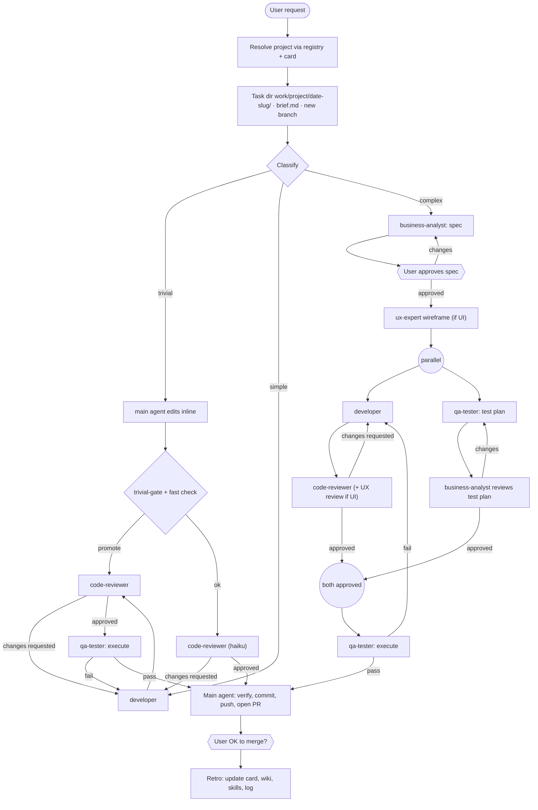

# Trailbook

**A persistent, agent-maintained workspace that gives AI coding agents long-term memory, project awareness, and reusable know-how — while spending as few tokens as possible.**

Open any AI agent (Claude Code, Codex, …) in this folder and it immediately knows:

- **what we know** → `wiki/`
- **what we work on** → `projects/`
- **how we do repeat work** → `skills/` and `agents/`

---

## Why this exists

Working with AI agents across many sessions and many repositories has three recurring costs:

1. **Amnesia.** Every new session starts from zero. Knowledge gathered yesterday — an article read, a design decision, a debugging insight — is lost in chat history.
2. **Expensive re-discovery.** To answer "what is this project?" an agent reads READMEs, manifests, and source files, burning thousands of tokens to recover a few key facts it has learned before.
3. **Re-inventing procedures.** Repetitive tasks (release a service, onboard a repo, run a review loop) get figured out from scratch each time, with the same trial and error.

Trailbook fixes this by having agents **write things down once, in small, structured, cheap-to-read files**, and by **routing** every request to the cheapest file that can answer it. The agents do the bookkeeping; the human curates, asks questions, and approves.

## Core principles

### 1. Tiered reads — cheapest first

Agents must stop at the first tier that answers the question:

| Tier | What | Typical size |
|---|---|---|
| T0 | `AGENTS.md` — rules + router (always loaded) | ~110 lines |
| T1 | `wiki/index.md`, `projects/index.md`, `skills/index.md` — one line per item | tiny |
| T2 | Head of a page or card (frontmatter + TL;DR) | ~20 lines |
| T3 | Full wiki page or full skill | small |
| T4 | Project source code, raw source documents | large — only for real work |

An agent should never open a repository just to learn what a project is — the project card answers that.

### 2. AGENTS.md routes, skills explain

`AGENTS.md` stays short: it says *where to go* for each kind of request. Long procedures live in skills that are loaded only when needed, so they cost nothing the rest of the time.

### 3. Compounding knowledge

Following the [*LLM Wiki*](https://gist.github.com/karpathy/442a6bf555914893e9891c11519de94f) pattern, knowledge is compiled once into interlinked pages and kept current — not re-derived on every question. Good answers are filed back into the wiki, so explorations accumulate.

### 4. Agents maintain it, humans steer it

Agents create wiki pages, project cards, and skills on their own — but they **always announce** what they saved, and the human can veto. Destructive or outward-facing actions (spec approval, merging a PR, using the most expensive model) require explicit human approval.

### 5. Spend tokens deliberately

Subagents keep heavy work (file reads, test output) out of the main session; each step uses the cheapest model that can do the job; agents pass file *paths* to each other, never file contents.

---

## Layout

```
trailbook/
├── README.md                 this file (for humans)
├── AGENTS.md                 rules + router (for agents); CLAUDE.md is a symlink to it
├── log.md                    append-only log of every workspace operation
│
├── wiki/                     general personal knowledge base (Obsidian-compatible)
│   ├── index.md              catalog: one line per page
│   ├── raw/                  immutable source documents — never edited (raw/sessions/ = transcripts)
│   ├── sources/              src-*      one summary per ingested source (incl. sessions)
│   ├── decisions/            decision-* the whys: decision, reasons, alternatives rejected
│   ├── entities/             entity-*   people, orgs, tools, products
│   ├── concepts/             concept-*  ideas, techniques, patterns
│   └── notes/                note-*     syntheses, comparisons, filed answers
│
├── projects/
│   ├── index.md              registry: name · aliases · one-liner · path
│   ├── ws_<name>.md          project card (≤ 40 lines) — tracked in git
│   └── <name>/               the actual git checkout — gitignored
│
├── skills/                   reusable procedures (exposed to Claude Code via .claude/skills)
│   ├── index.md
│   ├── _template.md
│   └── <name>/SKILL.md
│
├── agents/                   dev-workflow subagent roles (exposed via .claude/agents)
├── work/                     dev task artifacts: briefs, specs, reviews, QA reports
├── tools/                    helper scripts
└── .obsidian/                vault config (wikilinks, attachments, hides project checkouts)
```

---

## The four pillars

### 1. Wiki — what we know

A general personal knowledge base covering any domain: tech, work, health, finance, learning, people, home, and more.

- **Raw sources** go into `wiki/raw/` and are made read-only. They are the source of truth.
- **Pages** are written and maintained by agents. Every page starts with frontmatter and a 1–3 line **TL;DR**, so most lookups stop after reading ~20 lines.
- **Links** use Obsidian `[[wikilinks]]`; open the workspace root as an Obsidian vault to browse the graph.
- **Contradictions** are never silently overwritten — both claims are kept, with sources, under a `## Conflicts` heading.
- **Secrets** never go in the wiki; it records only *where* a secret lives.
- **No code** in the wiki — only decisions, reasons, facts, and pointers (paths, PRs, task folders).

**Ingest always runs in a subagent.** The main agent stores the raw source and spawns `wiki-ingester` on **haiku** (pennies per source). It moves to sonnet only for long, dense sources or when the ingester replies `ESCALATE`, and to opus only if sonnet escalates.

**Every session feeds the wiki.** When you say the session is done ("done", "wrap up", "that's all"), `session-close` runs `tools/session-extract.mjs`, which shrinks the transcript to user messages, assistant prose, and one-line action summaries (no code, no tool output, secrets redacted — a 2 MB transcript became ~30 KB). The ingester then files the session's decisions as `decision-` pages, so "why did we…?" questions are answered from a TL;DR.

**You are reminded.** Filing needs a deliberate "done". A SessionStart hook shows this at the start of every session, the agent repeats it when a piece of work finishes, and a SessionEnd hook records any session that ended without filing so the next session offers to file it.

Operations (each is a skill):

| Skill | Purpose |
|---|---|
| `wiki-ingest` | Store a source in `raw/`, then a `wiki-ingester` subagent (haiku by default) writes the summary, decision, and entity/concept pages, index, and log |
| `session-close` | When you say the session is done: extract the transcript (code-free), and a haiku ingester files its decisions and whys |
| `wiki-query` | Answer from the wiki via tiered reads, with citations; file valuable answers into `notes/` |
| `wiki-lint` | Health check: broken links, orphans, unindexed pages, stale or conflicting content |

### 2. Projects — what we work on

Every project is a git repository checked out into `projects/<name>/`. When a project is checked out it is **onboarded** (skill `onboard-project`):

1. Clone into `projects/<name>/`.
2. Run a **cheap probe** — about eight small, truncated reads (remote, branch, recent commits, top-level layout, README head, main manifest, build/test commands). No source files are read.
3. Write the **project card** `projects/ws_<name>.md`: purpose, aliases, stack, key entry points, commands, gotchas, and a *pointer* (not a copy) to the repo's own instruction file.
4. Add a line to `projects/index.md`, log it, and ask the user to confirm the project's purpose.

When the user mentions a project, the agent matches it by name or alias in the registry, reads the card, and only then touches the repository.

**Git:** checkouts are gitignored, but cards are tracked, so every project stays registered. On a new machine:

```bash
git clone <trailbook-remote> trailbook && cd trailbook
node tools/projects-restore.mjs        # re-clones every registered project from its card
```

### 3. Skills — how we do repeat work

Skills are short, step-by-step procedures written from what *actually worked*. Agents create them **proactively** when a task:

1. will recur,
2. took real discovery (trial and error, non-obvious order or flags), and
3. succeeded and is stable.

Every new or updated skill is announced in the same reply — `saved skill <name> (new|updated): <what it does> → <path>` — and the user can veto it.

Skills use the Claude Code `SKILL.md` format, so Claude Code discovers them automatically through the `.claude/skills` symlink. Other agents find them through `skills/index.md`.

Current skills:

| Group | Skills |
|---|---|
| Workspace | `onboard-project`, `wiki-ingest`, `session-close`, `wiki-query`, `wiki-lint`, `skill-create`, `present-visually` |
| Dev workflow | `dev-workflow`, `simple-change`, `complex-change`, `a11y` |

### 4. Dev workflow — how code changes get made

**Any development work in a project must start with the `dev-workflow` skill** (enforced in `AGENTS.md`). The main agent becomes an **orchestrator**: it never writes project code itself. Work is done by role-based subagents defined in `agents/`, so their file reads and test output stay out of the main session.

| Role | Does | Writes |
|---|---|---|
| `business-analyst` | Writes the spec; reviews the QA test plan | `spec.md`, `ba-review-n.md` |
| `ux-expert` | Wireframes before dev, UI review after (UI changes only) | `ux.md`, `ux-review-n.md` |
| `developer` | Implements; never commits | `dev-n.md` |
| `code-reviewer` | Reviews the diff against brief/spec; read-only | `review-n.md` |
| `qa-tester` | Prep: test plan. Execute: writes and runs tests | `test-plan.md`, `qa-n.md` |

Each change is classified first:

- **Trivial** — typo, rename, config value, copy text (≤ 2 files, ≤ 20 lines). The main agent edits inline; a mechanical diff gate (`tools/trivial-gate.mjs`) and one cheap review promote it to simple on any doubt.
- **Simple** — bug fix or small tweak in one library, no data-model or API change.
- **Complex** — new feature, multiple libraries, data-model, migration, or public API change. When unsure, the agent picks complex.



Rules that keep it safe and cheap:

- **Handoff protocol:** subagents receive file paths only, write their output to the task folder, and end with a fixed three-line block (`STATUS / ARTIFACT / SUMMARY`). The orchestrator reads only that block.
- **Plans are reviewable later:** specs stay precise in `work/`, a visual `review.md` digest (mermaid, tables, annotated HTML mockups) is shown chunk by chunk via the `present-visually` skill, and `work/index.md` lets any session find "the plan for feature X in project Y".
- **Every spawn is announced** before it happens: `🤖 spawning <role> — <what it will do> — model <model>/<effort>` (plus `🔁 resuming` for re-rounds and `⬆️ escalating` for model upgrades).
- **Re-rounds reuse the same agent**, so it doesn't re-read the code.
- **Loop limit:** each review/QA/spec loop runs at most 3 rounds, then the agent stops and asks the user.
- **Fresh base, branch, PR.** Every task starts from the project's default branch pulled to the latest (`tools/checkout-base.mjs`), then a task branch. Nothing is ever committed or pushed to the default branch.
- **Nothing in the way is lost.** Leftover files, conflicts, or unpushed local commits are backed up, committed to a `rescue/…` branch with a draft PR, and noted in `work/` before the switch; the agent tells you and recommends a separate session when it looks serious.
- **Only the main agent commits.** PRs are opened automatically; **merging requires the user's go-ahead.**
- **Accessibility:** any UI change applies the `a11y` skill (WCAG 2.2 AA) in every role.
- **Retro:** after each task, learned commands and gotchas go into the project card, domain knowledge goes into the wiki, and reusable procedures become skills.

#### Model routing

The orchestrator picks a model and effort level for every subagent it starts — the cheapest that can do the job:

| Role | Trivial | Simple | Complex |
|---|---|---|---|
| BA spec | — | — | opus · high |
| BA test-plan review | — | — | sonnet · medium |
| UX | — | sonnet | sonnet · high |
| developer | haiku | sonnet | opus · high |
| code-reviewer | haiku · low | sonnet | opus · high |
| QA prep | — | — | sonnet |
| QA write + run tests | haiku | sonnet | sonnet · high |
| QA re-run after a fix | haiku | haiku | haiku |

- Security, auth, payments, data migrations, concurrency, and public APIs always get opus.
- On complex work the reviewer is at least as strong as the developer.
- If the same gate fails twice, the next attempt moves up one tier (haiku → sonnet → opus).
- The most expensive model (fable) is never used by default, and only after asking the user.
- A project card can override the table with a `**Models:**` line; the retro step tunes it over time.
- Every model choice is recorded in the task's `status.md`.

---

## Works with Claude Code and GitHub Copilot

Trailbook is built so both agents get the same behavior from the same files — no duplicated config:

| Piece | Claude Code | GitHub Copilot (VS Code agent mode / CLI) |
|---|---|---|
| Rules + router | `CLAUDE.md` → `AGENTS.md` | `AGENTS.md` |
| Skills | `.claude/skills/` → `skills/` | same folder (Copilot reads `.claude/skills/`) |
| Subagents | `.claude/agents/` → `agents/` | same folder (Copilot reads Claude-format agents and maps tools and `haiku`/`sonnet`/`opus`) |
| Per-step model routing | `model` on each spawn | explicit model on `runSubagent`, else the agent file's `model:` |
| Hooks | `.claude/settings.json` | same file (Copilot reads it; PascalCase events get the same snake_case fields) |
| Session transcript → wiki | Claude Code transcripts | VS Code Copilot chat sessions (auto-detected by `tools/session-extract.mjs`) |

Known differences, handled in the skills:
- **Copilot subagents are stateless**, so review/QA re-rounds start a fresh agent with the latest task-dir files instead of continuing the previous one.
- **Copilot doesn't show hook banners**, so the agent states the filing reminder itself in its first reply.
- **Copilot's session-end payload has no transcript path**; a `Stop` hook remembers it, with a lookup by session id as fallback.
- **Copilot CLI / cloud agent transcripts aren't parsed**; `session-close` falls back to the agent writing the session summary itself.

### Requirements

`git`, plus **Node ≥ 18 (recommended)** or plain `bash`. Every tool ships twice with identical behaviour and output: `tools/<name>.mjs` — zero-dependency Node (built-ins only, no `npm install`), a single process per run, which is what keeps tooling fast on Windows where every process a bash script forks is expensive — and `tools/<name>.sh`, the fallback that needs nothing beyond Git itself (no Python, no `jq`, no Node): on a locked-down enterprise machine plain **Git for Windows (Git Bash)** is enough; WSL works too. The `.sh` twins use only what ships with Git Bash, macOS and Linux (coreutils, `grep`, `sed`, and core `perl` for `tools/session-extract.sh`). Agents run `node tools/<name>.mjs`, or `bash tools/<name>.sh` when `node` is not on the PATH; the hooks pick automatically. Hooks are **fail-safe**: if a tool is missing, the folder is opened from a subdirectory, or anything goes wrong, they exit silently and never block a session — the agent still gives the filing reminder from `AGENTS.md`. No absolute paths are tracked, so a fork works on any machine.

## Getting started

Trailbook is a template: your copy will fill up with personal knowledge, so keep it **private**.

```bash
git clone https://github.com/johnfabre/trailbook my-trailbook && cd my-trailbook
git remote rename origin upstream      # pull framework updates later: git fetch upstream && git merge upstream/main
git remote add origin <your-private-repo-url> && git push -u origin main
```

## How to use it

Start your agent in the workspace root (`cd my-trailbook && claude`). Then just talk to it:

| You say | What happens |
|---|---|
| "Check out github.com/org/billing-api" | `onboard-project`: clone, cheap probe, card, registry line |
| "In billing, fix the rounding bug on invoices" | `dev-workflow` → classified simple → developer / reviewer / QA → PR |
| "Add CSV export to billing" | `dev-workflow` → complex → spec for your approval → full flow → PR |
| "Read this article: <url>" | `wiki-ingest`: raw copy, summary, linked pages, index, log |
| "What do we know about Postgres RLS?" | `wiki-query`: answer from the wiki with citations |
| "Review the plan for CSV export in billing" | `work/index.md` → task → chunked visual review (`present-visually`) |
| "Health-check the wiki" | `wiki-lint` + `tools/wiki-lint.mjs` |
| "What did we do recently?" | reads the tail of `log.md` |
| "Why did we pick X?" | `wiki-query` → `## Decisions` in the index → TL;DR |
| "Done for today" | `session-close`: transcript → haiku ingester → decisions + learnings in the wiki |

Browse the knowledge base in **Obsidian** by opening your workspace folder as a vault.

### Tools

Each script exists as `.mjs` (Node, primary) and `.sh` (bash fallback) — same arguments, same output. `tools/_lib.mjs` holds the helpers the `.mjs` scripts share.

| Script | Purpose |
|---|---|
| `tools/wiki-lint.mjs` | Mechanical lint: broken links, unindexed pages, orphans, missing TL;DRs, unindexed skills/cards. Exit 0 = clean |
| `tools/projects-restore.mjs [name…]` | Re-clone registered projects whose checkout is missing |
| `tools/project-skill-link.mjs [name…]` | Expose tracked project skills (`projects/ws_<name>.skill.md`) to the harness as `skills/ws-project-<name>/` (symlink, or copy where symlinks are unavailable) |
| `tools/trivial-gate.mjs <repo> [files] [lines]` | Size/risk gate for trivial changes: `OK` or `PROMOTE` (too big, risky path, binary) |
| `tools/checkout-base.mjs <project> [base]` | Switch a project to its default branch and pull; if leftovers, conflicts, or local commits are in the way, save them (local backup, rescue branch + draft PR, note) first |
| `tools/session-extract.mjs [session-id] [-o file]` | Session transcript → compact, code-free markdown for ingest |
| `tools/obsidian-open.mjs <vault-relative path>` | Open a vault file in Obsidian via the `obsidian://` URI (Linux / macOS / Windows) |
| `tools/session-hook.mjs start\|stop\|end` | Session hook (Claude Code + Copilot): reminds you at session start that filing needs a deliberate "done"; flags sessions that ended unfiled |

---

## What has been built so far

- **Workspace scaffold:** `AGENTS.md` (with `CLAUDE.md` symlink), the wiki/projects/skills/agents/work/tools layout, append-only `log.md`, and git with project checkouts ignored.
- **Wiki:** seeded by ingesting the LLM Wiki idea file — one source page, one concept page, two entity pages (Obsidian, qmd).
- **Projects:** registry, card template, cheap-probe onboarding, staleness refresh, and a restore script tested end to end. No real project onboarded yet.
- **Skills:** five workspace skills plus four dev-workflow skills, all indexed and auto-discoverable by Claude Code.
- **Dev workflow:** five role subagents, simple and complex flows, a handoff protocol, loop limits, user gates, an accessibility checklist, and per-step model routing.
- **Obsidian:** vault config with wikilinks, attachment folder, and project checkouts hidden.
- **Quality:** `tools/wiki-lint.mjs` passes clean and was verified against a deliberately broken page. Each `.mjs` tool was checked against its `.sh` twin for identical output.

## Not done yet / next steps

- Onboard a first real project and run a full dev-workflow task end to end.
- Add proper search (e.g. [qmd](https://github.com/tobi/qmd)) once the wiki outgrows `index.md` + grep (~200 pages).
- Let the skills library grow from real use.

## Credits

The wiki layer is based on Andrej Karpathy's [*LLM Wiki*](https://gist.github.com/karpathy/442a6bf555914893e9891c11519de94f) idea file.
