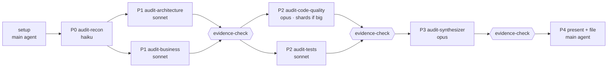
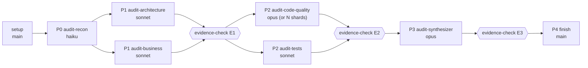

# Trailbook add-on: `repo-review`

**Take-over due diligence for a repository: 6 agents, 4 phases, one rated report, verified evidence and doc-ready facts.**
Drop-in for any Trailbook workspace (Claude Code and GitHub Copilot). Version 1.0 · 2026-11-26.

> **TL;DR:** tell your Trailbook agent *"install the repo-review add-on from \<this gist's URL\>"*. Then say *"review \<project\>"*.
> You get a 1–5 scorecard covering **architecture** (repo structure & config), **code quality**, **business/functional** and **test meaningfulness**. Every finding is pinned to `path:line` at a fixed commit and machine-checked, and a `facts/` folder lets a later session write the documentation.

---

## 1. What it does



| # | Agent | Model | Lens | Main output |
|---|---|---|---|---|
| P0 | `audit-recon` | haiku | mechanical map: stack, entry points, commands, skip paths, shard plan | `inventory.md` |
| P1 | `audit-architecture` | sonnet | repo structure, modularity, config & envs, deps, build/CI, tooling, secrets posture | `architecture.md` + **Intended design** |
| P1 | `audit-business` | sonnet | what the app does, capability criticality, data flows, error experience, integrity, rules, privacy, operability | `business.md` + **capability catalogue** |
| P2 | `audit-code-quality` | opus | patterns, anti-patterns, error handling, gotchas, hotspots, type safety, judged **against the Intended design** | `code-quality.md` + gotchas list |
| P2 | `audit-tests` | sonnet | what tests **prove**: per-test classification, capability → test strength, failure paths, mutation reasoning | `tests.md` |
| P3 | `audit-synthesizer` | opus | truth pass on serious findings, cross-lens chains, architecture × business overview, final scores, roadmap | `report.md` + `handoff.md` |

Two small tools do the mechanical work, each as a node + bash pair (Trailbook convention):
`tools/repo-inventory` (reproducible repo map at a pinned commit) and `tools/evidence-check` (every finding's `path:line` and quote verified against that commit, to catch hallucinated findings before they reach a score).

### Why this order
- **Architecture ∥ business** (P1): their inputs don't overlap, and isolation stops technical opinions from colouring the business read.
- **Code quality after architecture**: it judges violations of *this repo's* intended layering and patterns, not generic taste.
- **Tests after business**: a test is *meaningful* when it protects a capability that matters. The business catalogue supplies the list and its criticality.
- **Synthesis last**: re-reads every blocker/major (are they true, not just present?), links one problem seen from several lenses (user sees a generic 500 ← repository swallows the DB error ← no failure-path test), and applies the rubric.
- **Agents per repo**: 6, plus up to 3 extra code-quality shards on big repos (> 60k code lines / > 600 files / > 6 modules).

## 2. Ratings (fixed rubric, so scorecards from different repos can be compared)
| Aspect | Sub-areas (★ = critical, gates apply) |
|---|---|
| **A** Architecture | A1 layout & modularity · A2★ config & environments · A3 dependencies · A4 build, run & CI · A5 tooling & conventions · A6★ secrets & security posture |
| **C** Code quality | C1 consistency with intended design · C2 anti-patterns · C3★ error handling · C4★ gotchas & footguns · C5 complexity hotspots · C6 type & contract safety |
| **B** Business | B1 capability completeness · B2★ data flow & integrity · B3 error experience · B4 business rules & edge cases · B5★ security & privacy as perceived · B6 operability |
| **T** Tests | T1 meaningfulness · T2★ critical capability coverage · T3 failure & edge paths · T4 slop ratio · T5 bug-catching power |

- Every sub-area is scored 1–5 with written anchors, a confidence level and the finding IDs behind it.
- Overall = weighted (A 20 · C 30 · B 30 · T 20), with **gates**: a critical sub-area at 1 caps the overall at 2.0, so one disaster can't be averaged away.
- Verdict bands: **healthy ≥ 4.0 · workable 3.0–3.9 · risky 2.0–2.9 · critical < 2.0**.

The test lens sorts every sampled test as **B**ehavioural · legit **I**nteraction · **C**oupled to implementation · ta**X**utological · **W**eak/no assertion · **S**napshot-only · **D**uplicate · **F**ramework/trivial. Meaningful = B + I, slop = X + W + D + F (+ S). A real mutation run is optional (exec policy `mutation`, always in a sandbox copy).

## 3. Outputs: `work/<project>/<date>-repo-review/`
```
brief.md  status.md  inventory.md  architecture.md  business.md  code-quality[.k].md  tests[.k].md
evidence-1.txt  evidence-2.txt  evidence-3.txt  report.md  handoff.md  review.md (visual digest)
facts/  build-and-run · module-map · config-reference · dependencies · capabilities · data-flows
        integrations · error-catalogue · business-rules · glossary · conventions · test-map
```
**Findings** and **facts** share one machine-checked line format:
```
- [ARCH-007] major | high | src/config/index.ts:12-30, src/server.ts:4 | [A2] claim → impact → fix
  > `verbatim snippet from the first location`
```
Facts are neutral (what *is*, never what *should be*), so a documentation session can use them directly. `handoff.md` maps them onto a suggested doc set (README, architecture overview, config reference, runbook, functional guide, contributor & testing guide).

## 4. Requirements
- A Trailbook workspace with `AGENTS.md`, `skills/`, `agents/`, `work/index.md` and **`tools/_lib.mjs`** (Trailbook ≥ 2026-11-12, "every tool gets a Node twin").
- `git`, plus **node ≥ 18** *or* **bash** (Git for Windows / macOS bash 3.2 / Linux). Nothing else: no python, jq or npm packages.
- The repos to review get onboarded as Trailbook projects (`onboard-project`). The review is read-only on them.

---

## 5. Install

**Human:** in your Trailbook workspace, tell your agent:
> install the repo-review add-on from https://gist.github.com/&lt;user&gt;/&lt;id&gt;

**Agent: follow these steps exactly, from the workspace root.**

1. **Preconditions**: `AGENTS.md`, `skills/index.md`, `work/index.md` and `tools/_lib.mjs` must exist. If `tools/_lib.mjs` is missing, stop and tell the user their Trailbook predates the node tools and needs updating first.
2. **Fetch this file unmodified** to `.trailbook/repo-review-gist.md` (`.trailbook/` is gitignored). Do not retype it.
   ```bash
   mkdir -p .trailbook
   curl -fsSL https://gist.githubusercontent.com/<user>/<id>/raw/trailbook-repo-review.md -o .trailbook/repo-review-gist.md
   # or: gh gist view <id> --raw --filename trailbook-repo-review.md > .trailbook/repo-review-gist.md
   # or: the user hands you the file; copy it there
   ```
3. **Dry run**: list the targets and make sure none exist yet. If any exist, show the list and ask the user (overwrite = upgrade, see §7).
   ```bash
   G=.trailbook/repo-review-gist.md
   grep -E '^~~~~[a-z]* file=' "$G" | sed 's/.* file=//'
   for f in $(grep -E '^~~~~[a-z]* file=' "$G" | sed 's/.* file=//'); do [ -e "$f" ] && echo "EXISTS $f"; done
   ```
4. **Extract** every file block mechanically. Never write the code by hand.
   ```bash
   awk '
     /^~~~~[a-z]* file=/ { f = $0; sub(/^.* file=/, "", f)
       if (f ~ /^\// || f ~ /\.\./) { print "refusing path " f > "/dev/stderr"; exit 1 }
       d = f; if (sub(/\/[^\/]*$/, "", d)) system("mkdir -p \"" d "\""); next }
     /^~~~~$/ { if (f != "") close(f); f = ""; next }
     f != "" { print > f }
   ' .trailbook/repo-review-gist.md
   chmod +x tools/repo-inventory.mjs tools/repo-inventory.sh tools/evidence-check.mjs tools/evidence-check.sh
   ```
5. **Wire it into the workspace** (small edits; if an anchor line differs in this workspace, put the line in the equivalent spot and tell the user):
   - `AGENTS.md` Layout block, after the `tools/obsidian-open.mjs` line, add:
     ```
     tools/repo-inventory.mjs     mechanical repo map at a pinned commit (skill repo-review, P0)
     tools/evidence-check.mjs     verify review findings' path:line + quotes against a commit (repo-review gates)
     ```
   - `AGENTS.md` Layout: `agents/<role>.md     subagents: dev-workflow roles + wiki-ingester` → append ` + audit-* (repo-review)`.
   - `AGENTS.md` Router table, after the `"lint / health-check the wiki"` row, add:
     `| "review / audit / assess / take over <repo>" (a whole repo, not a diff) | skill \`repo-review\` (read-only, 6 audit-* subagents, rated report + doc facts) |`
   - `AGENTS.md` Log format: add `review` to the `<op>` list.
   - `skills/index.md` under `## General`, above the `<!-- agent-created cross-project skills go here -->` comment:
     `- [repo-review](repo-review/SKILL.md) — take-over due diligence: architecture, code quality, business, test meaningfulness → rated report + doc-ready facts`
   - `work/index.md` line-format comment: `<simple|complex|plan>` → `<simple|complex|plan|review>`.
6. **Self-test** (both twins must agree; skip the half whose runtime is missing):
   ```bash
   T=.trailbook/repo-review-selftest; rm -rf "$T"; mkdir -p "$T/repo"
   git -C "$T/repo" init -q
   printf 'line one\nconst x = 1;\n' > "$T/repo/a.js"
   git -C "$T/repo" add a.js && git -C "$T/repo" -c user.name=selftest -c user.email=selftest@example.invalid commit -qm init
   printf '%s\n' '- [T-1] good | high | a.js:1-2 | passes' '  > `const x  =  1;`' \
     '- [T-2] major | high | a.js:9 | fails: beyond end of file' '- [T-3] info | low | !b.js | passes: absent' > "$T/r.md"
   node tools/evidence-check.mjs "$T/repo" HEAD "$T/r.md" > "$T/n.txt"; bash tools/evidence-check.sh "$T/repo" HEAD "$T/r.md" > "$T/b.txt"
   diff "$T/n.txt" "$T/b.txt" && cat "$T/n.txt"
   node tools/repo-inventory.mjs . > "$T/n.md"; bash tools/repo-inventory.sh . > "$T/b.md"; diff "$T/n.md" "$T/b.md" && echo "inventory twins agree"
   node tools/wiki-lint.mjs
   rm -rf "$T"
   ```
   Expected: no diff, then exactly
   ```
   FAIL T-2 .trailbook/repo-review-selftest/r.md:3 a.js:9 — line 9 beyond end of file (2 lines)
   STATUS: FAIL
   CHECKED: 3 findings, 3 locations, 1 quotes
   FAILED: 1 (T-2)
   inventory twins agree
   lint: clean
   ```
7. **Clean up and record**: `rm .trailbook/repo-review-gist.md`. Append to `log.md`:
   ```
   ## [YYYY-MM-DD] setup | repo-review add-on installed (gist v1.0)
   - skills/repo-review/{SKILL,rubric,templates}.md, agents/audit-*.md (6), tools/{repo-inventory,evidence-check}.{mjs,sh}
   - AGENTS.md (layout, router, log ops), skills/index.md, work/index.md format line
   ```
8. **Announce** (AGENTS.md rule): `saved skill repo-review (new): take-over due diligence with 6 audit-* agents → skills/repo-review/SKILL.md`.
   Tell the user to **start a new session** so the harness registers the new agents (`.claude/agents` → `agents/`). Commit only if the user asks; suggested message: `feat: add repo-review add-on (6 audit agents, rubric, evidence tools)`.

## 6. Use
| Say | What happens |
|---|---|
| "review acme" / "we're taking over acme, audit it" | full pipeline on the onboarded project `acme` (onboards it first if needed) |
| "review acme, you may run the tests" | exec policy `tests`: tests (+ coverage) run in a sandbox copy |
| "review acme with mutation testing" | exec policy `mutation`: a scoped mutation run in the sandbox |
| "review acme and billing, compare them" | two pipelines + a portfolio scorecard table |
| "show the review for acme" | `work/index.md` → `review.md` digest, chunk by chunk |
| afterwards, new session: "write documentation for acme from work/acme/<dir>/handoff.md" | docs session through `dev-workflow`, built from verified facts |

The main agent asks at most once for the exec policy and focus questions (defaults: `static`, none). It announces every spawn (`🤖 spawning audit-business — … — model sonnet/high`) and reads only the agents' STATUS blocks until the end, so its context stays small.

## 7. Upgrade / uninstall
- **Upgrade**: steps 2–4 with the new gist version, after showing the user `diff` of each existing target vs the new block; then steps 6–8 (log `setup | repo-review add-on upgraded (vX)`).
- **Uninstall**: delete `skills/repo-review/`, `agents/audit-*.md`, `tools/repo-inventory.*`, `tools/evidence-check.*`; revert the step-5 lines; run `node tools/wiki-lint.mjs`; log it. Existing `work/*/…-repo-review/` dirs are history: keep them.

---

## 8. Files
Each block below is one file. Its target path follows `file=`. Extract with step 4. Do not edit them by hand during install.

### `skills/repo-review/SKILL.md`

~~~~markdown file=skills/repo-review/SKILL.md
---
name: repo-review
description: Take-over due diligence on a whole repository. Covers architecture (repo structure and configuration), code quality, a business/functional view and how meaningful the unit tests are. Each is rated 1–5 on a fixed rubric, backed by machine-verified evidence, with doc-ready facts for a later documentation session. Six audit-* subagents run in four phases and are read-only on the repo. Use when the user says "review / audit / assess / rate / due-diligence <repo or project>", "we're taking over <repo>", or "is <repo> any good".
updated: 2026-11-26
---

# Repo review

Read-only due diligence on **one repo at one pinned revision**. The main agent orchestrates and never reviews code itself. The `audit-*` roles do the reading. Nothing is written into the project repo.

Companion files (same folder): `rubric.md` (scores, anchors, aggregation) · `templates.md` (finding format, report skeletons, facts, handoff).

## When to use / not
- ✅ Inheriting or taking in a repo: judge structure & config, code quality, what it does for the business, test meaningfulness.
- ❌ Reviewing a diff or PR → `code-reviewer` in `dev-workflow`. ❌ Ecosystem/integration fit across repos → out of scope.
- ❌ Writing the docs → separate session that starts from this review's `handoff.md` (§9).

## 1. Pipeline



| Phase | Role(s) | Primary input | Why here |
|---|---|---|---|
| P0 | audit-recon | `tools/repo-inventory` output | One cheap map that every later role reuses, so nobody re-crawls the repo |
| P1 | audit-architecture ∥ audit-business | inventory | Independent lenses. Isolation keeps technical opinion from colouring the business view |
| P2 | audit-code-quality ∥ audit-tests | P1 reports | Code quality judges against the **intended design** from architecture. Tests judge against the **capability map + criticality** from business ("meaningful" = protects something that matters) |
| P3 | audit-synthesizer | everything, after E2 | Truth pass on serious findings, cross-lens chains, architecture × business overview, final scores |

## 2. Setup (main agent)
1. **Resolve project**: `projects/index.md` → card. Not onboarded → skill `onboard-project` first (the card + project skill are free context for every role). Card `skill:` set → load that project skill now, because repo AI files may define conventions the reviewers must know about.
2. **Fresh base**: `node tools/checkout-base.mjs <name>` (rescue rules as in `dev-workflow` §4). To review another ref, run `git -C projects/<name> switch --detach <ref>` afterwards.
3. **Pin**: `REV=$(git -C projects/<name> rev-parse HEAD)`. All evidence is checked against REV. **Never move the checkout while the review is open.** A dev task on the same project waits, or the review gets restarted.
4. **Task dir** `work/<name>/<YYYY-MM-DD>-repo-review/` with `facts/` inside. Add a line to `work/index.md` under `## Open`:
   `- <name> · [<YYYY-MM-DD>-repo-review](<name>/<YYYY-MM-DD>-repo-review/) — repo review · review · in-progress · doc: report.md · PR: —`
5. **`brief.md`** from `templates.md` §1: repo, REV, card, exec policy, weights, the user's focus questions, out-of-scope paths.
6. **Ask the user only for what you cannot default** (one message, only if they haven't said already): exec policy (default `static`), focus areas, anything off-limits. Don't block: if there's no answer, use the defaults and note them in the brief.
7. `status.md`: first line `HH:MM setup REV=<sha12> exec=<policy>`.

### Exec policy (in `brief.md`)
| policy | roles may run | never |
|---|---|---|
| `static` (default) | read-only git/grep/find and the two review tools | anything that builds, installs or runs project code |
| `tests` | + the project's own install + test command (+ coverage), **in a sandbox copy** (§6) | deploy, migrations, seeders, scripts that call external services, global installs |
| `mutation` | + a scoped mutation-testing run in the sandbox | same as above |
Anything outside the policy → that role returns `BLOCKED` with the exact command it wanted. The main agent asks the user.

## 3. Phases (spawn protocol in §5)
**P0 recon**: spawn `audit-recon`. Output: `inventory.md` (tool output + `## Recon notes`) and the seed `facts/build-and-run.md`. Read its SUMMARY. If it proposes shards, put the shard plan into `brief.md § Shards` (§4).

**P1**: spawn `audit-architecture` and `audit-business` **in the same message** (parallel).
**Gate E1**:
```bash
T=work/<name>/<dir>
node tools/evidence-check.mjs projects/<name> $REV $T/architecture.md $T/business.md $T/facts/*.md > $T/evidence-1.txt
tail -3 $T/evidence-1.txt
```
`FAIL` → resume each owning role (ID prefix → role, table in `templates.md` §2) with `fix the FAIL lines for your IDs in <T>/evidence-1.txt (correct the location/quote, or delete the finding if it cannot be evidenced)`. Re-run as `evidence-1b.txt`. Max **2 fix rounds**. IDs still failing go to `status.md` as `dropped: <ids>`. The synthesizer excludes them.

**P2**: spawn `audit-code-quality` (or its shards) and `audit-tests` in the same message.
**Gate E2**: same command over **all** reports + facts → `evidence-2.txt`, same fix loop.

**P3**: spawn `audit-synthesizer`. **Gate E3** over `report.md` + `handoff.md` + all facts → `evidence-3.txt`. One fix round max.

**P4 finish** → §7.

## 4. Sharding (large repos)
Decide from `inventory.md` (Size, Top-level layout) and recon's proposed modules:
- **code-quality**: shard when code lines > **60k**, code files > **600**, or > **6 modules**. Group modules into shards of ~20–40k code lines, **max 4 shards**. Shard k gets `shard: k`, `scope: <paths>`, writes `code-quality.<k>.md` with IDs `CODE<k>-NNN` and `facts/conventions.<k>.md`.
- **tests**: shard only when test files > **400**. Same groups, `tests.<k>.md`, IDs `TEST<k>-NNN`, `facts/test-map.<k>.md`.
- Unsharded IDs: `CODE-NNN`, `TEST-NNN`. Each shard proposes scores for its scope only. The synthesizer merges them, weighted by code lines in scope.
Record in `brief.md § Shards`: `k | paths | code lines`.

## 5. Spawning (Trailbook handoff rules apply)
**Announce before every spawn** (AGENTS.md hard rule), one line per agent:
```
🤖 spawning audit-recon — inventory + recon notes for acme @3f2c9e1 — model haiku/low
🤖 spawning audit-architecture — structure & config review (P1) — model sonnet/medium
🤖 spawning audit-business — capabilities, flows, error UX (P1) — model sonnet/high
🔁 resuming audit-business r2 — fix 3 evidence FAILs in evidence-1.txt — model sonnet/high
⬆️ escalating audit-code-quality.2 sonnet → opus — shard report too shallow (4 findings / 30k lines)
```
**Prompt = paths only** (role file auto-loads; never paste file contents):
```
Task dir: work/<name>/<YYYY-MM-DD>-repo-review
Repo: projects/<name>    REV: <full sha>
Card: projects/ws_<name>.md    Brief: <task dir>/brief.md
Round: 1    Shard: - (or k, scope: <paths>)
Do: <one line, e.g. "P1 architecture review per your role file">
```
**Every role ends with exactly**:
```
STATUS: DONE | BLOCKED | ESCALATE
ARTIFACT: <task dir>/<file>.md
SUMMARY: <≤ 5 lines: findings by severity · proposed scores · biggest risk · what was NOT covered>
```
The main agent reads **only this block** plus `tail -3` of evidence-check output. It never opens the reports before P4. That keeps its context small.

**Harness mechanics**
| | Claude Code | GitHub Copilot |
|---|---|---|
| spawn | `Agent` with `subagent_type: audit-<role>`, `model` param | `runSubagent` / `task` naming `audit-<role>` + model |
| parallel | several calls in one message | if not available: architecture → business, then code-quality → tests (order doesn't change results, because each reads only earlier phases) |
| re-round | `SendMessage` to the same agent (keeps its code context) | stateless: fresh spawn, prompt adds `Round: n` + the evidence file path |
| no subagents at all | — | play each role inline from `agents/audit-<role>.md`, one at a time, artifacts identical. Compact/clear context between roles |

## 5a. Model routing
| Role | default | when to change |
|---|---|---|
| audit-recon | haiku · low | sonnet · low if `BLOCKED`/`ESCALATE` (exotic stack) |
| audit-architecture | sonnet · medium | opus · high: monorepo > 6 modules, polyglot, heavy infra-as-code |
| audit-business | sonnet · high | opus · high: payments, regulated data, multi-tenant, > 30 capabilities |
| audit-code-quality (unsharded) | opus · high | — |
| audit-code-quality (per shard) | sonnet · high | opus · high for the shard that holds critical capabilities (from business.md) |
| audit-tests | sonnet · high | opus · high when exec=`mutation` or > 1000 tests |
| audit-synthesizer | opus · high | never lower: it does the truth pass and the scores |
- Escalate one tier when a role returns `ESCALATE`, when evidence FAIL rate > 20 % after round 2, or when the synthesizer flags a report as shallow (`SHALLOW: <report>` in its SUMMARY → re-run that role one tier up, then re-run P3).
- fable: never by default (AGENTS.md / dev-workflow §5a rules).
- Log each transition in `status.md`: `HH:MM audit-business r1 [sonnet/high] DONE · 3B 9M 14m · B=3.2`.

## 6. Sandbox (exec ≠ static)
Never run project code in `projects/<name>/`. Make a throwaway copy of REV outside it:
```bash
SB=.trailbook/review-sandbox/<name>-<YYYY-MM-DD>     # .trailbook/ is gitignored
mkdir -p "$SB" && git -C projects/<name> archive "$REV" | tar -x -C "$SB"
```
Roles install and run only inside `$SB`, using the card's / repo's own commands. Mutation tools that rewrite files (mutmut, cosmic-ray, PIT) are then harmless. The main agent deletes `$SB` at P4. Needs secrets or services to run tests → `BLOCKED`, never invent credentials.

## 7. Finish (main agent)
1. Read `report.md` **top section only** (verdict + scorecard + top risks, ≤ 60 lines) and the last SUMMARY.
2. Present with skill `present-visually` (`present-cli` in a terminal): write `review.md` digest (`based_on: report.md`). Chunk 1 = verdict + scorecard table + pipeline diagram. Then one chunk each for architecture, code quality, business, tests, then risks & roadmap, then docs handoff. Wait between chunks.
3. **Card**: add or replace one line (card stays ≤ 40 lines):
   `**Review:** <date> @<sha7> · overall <x.x>/5 <verdict> (A <n> · C <n> · B <n> · T <n>) → work/<name>/<dir>/report.md`
4. `work/index.md` line → `done`, moved to `## Done`. Delete the sandbox if one was made.
5. Log: `## [date] review | <name>: repo review @<sha7> → <x.x>/5` + bullets (task dir, card).
6. Tell the user: scorecard (table), top 3 risks, path to `report.md`, and the docs-session starter line from §9. Then the filing reminder: `📚 say "done" when you're finished so I file this session into the wiki`.
7. Commit only if the user asks (the task dir is tracked workspace history).

## 8. Several repos
One pipeline per repo, each with its own task dir. Run them one after another by default (main context stays small). Run in parallel only when asked, announcing every spawn. Because the rubric is fixed, scorecards are comparable: on request, write `work/_workspace/<date>-repo-review-portfolio/plan.md` with one scorecard row per repo + links. No cross-repo/ecosystem analysis.

## 9. Docs session handoff
`handoff.md` (written by the synthesizer) is the only entry point a documentation session needs. Tell the user to start a **new session** with:
> write documentation for <name> from work/<name>/<dir>/handoff.md: facts only, cite fact IDs, re-check anything that changed since REV

Writing docs into the repo is dev work → that session goes through `dev-workflow`.

## Pitfalls
- **Generic advice instead of findings** → every finding needs a location (evidence-check enforces existence; the synthesizer re-reads every blocker/major for truth).
- **Line numbers drift** → pin REV, never pull mid-review; tools read git objects at REV, not the working tree.
- **Business view anchored on tech opinions** → audit-business must not read other lens reports (P1 isolation).
- **Test review that counts instead of judges** → per-test classification + capability map are mandatory outputs.
- **Scores without anchors** → `rubric.md` anchors; the synthesizer states the reason for every score change.
- **Secrets in the repo** → report path:line + type only. Never the value: no quotes, no facts, no chat.
- **Vendored/generated code skews everything** → recon lists skip-paths in `## Recon notes`; all roles skip them.
- **Main agent reading reports early** → context bloat. Read STATUS blocks only until P4.
~~~~

### `skills/repo-review/rubric.md`

~~~~markdown file=skills/repo-review/rubric.md
---
title: Repo review rubric (companion of repo-review/SKILL.md)
description: Fixed scoring rubric for skill repo-review. Covers 4 aspects and 23 sub-areas, 1–5 anchors, severities, confidence, test classification and aggregation with gates. Every audit-* role scores against this file so scorecards of different repos can be compared.
updated: 2026-11-26
---

# Repo review rubric

## 1. Scale (every sub-area)
| score | label | meaning |
|---|---|---|
| 5 | exemplary | could serve as a reference; no major findings; strengths clearly evidenced |
| 4 | solid | minor issues only; conventions clear and consistently followed |
| 3 | adequate | works; noticeable inconsistency; some majors, no blockers |
| 2 | weak | several majors **or** one blocker; real effort needed to work with it safely |
| 1 | failing | blockers; unsafe to change or ship without remediation |
| n/a | not applicable | e.g. no UI, no persistence; excluded from aggregates (say why) |

- **No score without evidence**: each score row cites ≥ 1 finding ID (a `good` finding counts).
- Scores are integers per sub-area. Aspect and overall scores carry one decimal.
- 2 and 4 sit between the written anchors: use them.

## 2. Severity (every finding)
| severity | use for |
|---|---|
| `blocker` | likely outage, data loss/corruption, security exposure, unbuildable, or unsafe to change at all |
| `major` | costs real time or risk regularly; fix within the first months of ownership |
| `minor` | friction or inconsistency; fix opportunistically |
| `info` | neutral observation that informs a score |
| `good` | a strength worth keeping. **Each lens reports ≥ 3, or states "none found"** |
| `fact` | neutral, doc-ready statement (only in `facts/`) |

## 3. Confidence
`high` = the relevant code was read broadly · `med` = sampled, pattern seen several times · `low` = inferred from limited evidence.
Aspect confidence = the **lowest** confidence among its critical (★) sub-areas' score rows.

## 4. Aspects and sub-areas (★ = critical: gates apply, §6)

### A · Architecture: repo structure & configuration (owner: audit-architecture)
| id | sub-area | look at | 1 | 3 | 5 |
|---|---|---|---|---|---|
| A1 | Layout & modularity | dir tree, packages/workspaces, module boundaries, dependency direction, shared/common dirs | dumping-ground folders, circular package deps, no telling where code goes | recognisable structure with notable exceptions | structure mirrors domain/layers; boundaries enforced by tooling |
| A2 ★ | Configuration & environments | how config loads, env separation, defaults, validation, `.env.example` vs vars actually read | env-specific values hard-coded, config scattered, prod-unsafe defaults | mostly central config, some hard-coding, no validation | one typed/validated source, every var documented, env changes need no code |
| A3 | Dependencies | manifests, lockfiles, version ranges, duplicate libs for the same job, abandoned/deprecated libs, dev/prod split | no lockfile or conflicting lockfiles, abandoned core deps | lockfile present, some stale or duplicated deps | lean, current, automated updates (renovate/dependabot) |
| A4 | Build, run & CI | one-command setup, scripts, CI coverage (lint/type/test/build), Dockerfiles, release | no CI, undocumented manual build | CI runs tests, misses lint/type or build | reproducible setup, CI gates every check, automated release |
| A5 | Tooling & conventions | lint/format/type configs and strictness, suppression counts, pre-commit, CONTRIBUTING/README accuracy, ADRs, AI instruction files | none, or present but contradicted by the code | present but lax (many suppressions, not in CI) | strict, enforced in CI, documented and accurate |
| A6 ★ | Secrets & security posture (config level) | committed credentials, `.gitignore` coverage, debug/CORS/TLS settings, dependency audit in CI | live-looking secrets committed | no secrets committed, but no scanning or guidance | secret manager, scanning in CI, hardened defaults documented |

### C · Code quality: patterns, anti-patterns, gotchas (owner: audit-code-quality)
| id | sub-area | look at | 1 | 3 | 5 |
|---|---|---|---|---|---|
| C1 | Consistency with intended design | layer violations vs `architecture.md § Intended design`, two-ways-to-do-one-thing | design not recognisable in code | mostly followed, several violations | followed throughout; deviations explained |
| C2 | Anti-patterns & design smells | god objects, copy-paste, deep inheritance, magic values, shotgun surgery, primitive obsession | pervasive in core modules | present in places, contained | rare and local |
| C3 ★ | Error handling in code | swallowed/catch-all errors, translation at boundaries, log-and-rethrow, cleanup, timeouts/retries | errors swallowed on critical paths; no timeouts | inconsistent but critical paths mostly sound | deliberate error model, consistent at every boundary |
| C4 ★ | Gotchas & footguns | concurrency/shared state, time zones, float money, N+1, injection, unsafe defaults, null handling, implicit ordering | exploitable or data-corrupting gotchas present | several latent gotchas, none critical | few, documented or guarded |
| C5 | Complexity & readability | hotspots (churn × size), long/nested functions, dead code, misleading names/comments | core hotspots unmaintainable | some hard hotspots, rest readable | small focused units; hotspots under control |
| C6 | Type & contract safety | type strictness, `any`/ignore escapes, validation at boundaries, API schemas vs implementation | untyped boundaries, schemas drift from code | typed core, loose edges | strict types plus validated boundaries |

### B · Business & functional: as perceived by business/users (owner: audit-business)
| id | sub-area | look at | 1 | 3 | 5 |
|---|---|---|---|---|---|
| B1 | Capability completeness | capabilities found vs implied; stubs, TODO flows, dead flags | core flows stubbed or broken | core complete, edges partial | complete, no dead or half-built flows |
| B2 ★ | Data flow & integrity | single source of truth, validation, transactions, idempotency, deletion/retention | multi-step writes without transactions, duplicate-on-retry, unvalidated input | integrity on main paths, gaps on edges | integrity guaranteed and evident everywhere |
| B3 | Error experience | what users/API clients see on invalid input, auth failure, not found, conflict, downstream failure, partial failure | raw errors/stack traces, silent failure, data left half-written | understandable on main paths, inconsistent contract | actionable, consistent, recoverable everywhere |
| B4 | Business rules & edge cases | rules centralised vs scattered/duplicated; limits, rounding, time zones, currency, roles | rules duplicated and contradictory | mostly central, some hard-coded constants | explicit, central, configurable where it should be |
| B5 ★ | Security & privacy as perceived | authn coverage per capability, authz/ownership/tenant checks, PII in responses/logs, audit trail | unauthenticated or cross-tenant access to sensitive capabilities | authn everywhere, authz uneven | least-privilege, audited, PII minimised |
| B6 | Operability & supportability | can support answer "what happened to customer X?": logs, correlation IDs, health checks, admin tools, flags | blind: no useful logs or health signal | basic logging, hard to trace one request | traceable per request, health and admin tooling present |

### T · Tests: what they prove, not how they're written (owner: audit-tests)
| id | sub-area | look at | 1 | 3 | 5 |
|---|---|---|---|---|---|
| T1 | Meaningfulness | share of meaningful tests (B + I, §5) in the classified sample | < 40 % | 60–75 % | > 90 % |
| T2 ★ | Critical capability coverage | critical capabilities (business.md) with **strong** tests | most critical have none/weak | about half strong | all critical strong |
| T3 | Failure & edge paths | error scenarios from business.md with tests; boundaries; invalid input | almost only happy paths | some failure paths on critical flows | failure paths systematically covered |
| T4 | Slop ratio | share of X + W + D + F (+ S when large/unreviewed) | > 40 % | 15–25 % | < 5 % |
| T5 | Bug-catching power | mutation reasoning sample (static) or real mutation score | most sampled mutations survive (real < 40 %) | about half killed (real 55–70 %) | nearly all killed (real > 85 %) |
T1/T4 bands in between: 2 = 40–60 % / 25–40 %, 4 = 75–90 % / 5–15 %. T5 real: 2 = 40–55 %, 4 = 70–85 %.
Coverage % (if exec allows) is **supporting evidence only**. It never drives a score on its own.

## 5. Test classification (audit-tests, per sampled test)
| code | class | definition | counts as |
|---|---|---|---|
| B | behavioural | asserts an outcome a caller can observe: return value, public state, response, persisted row, emitted event | meaningful |
| I | legit interaction | asserts a call on a **boundary** mock where the call *is* the behaviour (email sent, message published) | meaningful |
| C | implementation-coupled | asserts internal calls, private state or call order; breaks on a behaviour-preserving refactor | neither. Reported separately as a refactor blocker |
| X | tautological | asserts what the test itself set up; mocks the unit under test; expected value computed by the production code | slop |
| W | weak/no assertion | only not-null / defined / truthy / no-throw / length > 0, or nothing asserted | slop |
| S | snapshot-only | large snapshot with no targeted assertion | slop when large or obviously never reviewed |
| D | duplicate | same behaviour and partition as another test, trivially different input | slop |
| F | trivial/framework | getters/setters, constants, framework or generated-code behaviour | slop |
Capability test strength: **strong** = ≥ 1 meaningful test on the happy path **and** ≥ 1 on a failure path · **weak** = happy path only, or only C/W/S tests · **none**.

## 6. Aggregation (synthesizer; show the arithmetic in report.md)
1. **Aspect score** = mean of its sub-area scores (n/a excluded), one decimal. Then **cap**: aspect ≤ (lowest ★ sub-area + 1.0).
2. **Overall** = weighted mean of aspects. Default weights **A 20 % · C 30 % · B 30 % · T 20 %**. `brief.md` may override them (they must sum to 100).
3. **Gates**: any ★ sub-area = 1 → overall ≤ 2.0. Any unresolved `blocker` finding → `⚠ blockers` printed next to the overall score.
4. Sharded lenses: sub-area score = code-line-weighted mean of shard scores, rounded to an integer.
5. Synthesizer adjustments: it may move a proposed sub-area score by ±1 (more only with ≥ 2 cited findings), stating the reason in the scorecard's `change` column.

| overall | verdict | meaning for a take-over |
|---|---|---|
| ≥ 4.0 | **healthy** | take over as is; normal backlog |
| 3.0–3.9 | **workable** | take over; plan remediation alongside features |
| 2.0–2.9 | **risky** | remediate blockers/majors before feature work |
| < 2.0 | **critical** | reconsider the scope: stabilise or partially rebuild before committing |
~~~~

### `skills/repo-review/templates.md`

~~~~markdown file=skills/repo-review/templates.md
---
title: Repo review templates (companion of repo-review/SKILL.md)
description: Shared rules for every audit-* role, the machine-checked finding format, report skeletons, facts files, report.md and handoff.md layouts.
updated: 2026-11-26
---

# Repo review templates

## 0. Rules for every audit-* role (read before starting)
1. **Read-only on the repo.** No edits and no git state changes (no checkout, pull, stash, reset, worktree). No build, install or run unless `brief.md` exec policy allows it, and then **only in the sandbox** (`SKILL.md` §6).
2. **Pinned revision.** First command: `git -C <repo> rev-parse HEAD`. If it ≠ REV from the prompt → `STATUS: BLOCKED` ("checkout moved").
3. **Write only in the task dir**: your own report and the facts files you own (§4). Never another role's file.
4. **Isolation**: read only the inputs your role file lists. P1 roles never read each other's reports.
5. **Every finding uses the §2 format**, with a real `path:line` from the repo root. The tools check it mechanically.
6. **Secrets**: report path:line and the type (e.g. "AWS key", "DB password"). **Never the value**: no quotes of secret lines, not in facts, not in SUMMARY.
7. **Skip** the paths listed in `inventory.md § Recon notes → Skip paths` (vendored, generated, build output) unless the finding is *about* them (e.g. committed build output).
8. **Cheap reading**: `git -C <repo> grep -n` / Grep for patterns and counts. Read file *ranges*, not whole files, unless the file is central. No re-reading what inventory.md already states.
9. **Coverage statement is mandatory**: what you read fully, what you sampled (and how), what you skipped. An unread area is a stated gap, never a silent assumption.
10. **Fair**: ≥ 3 `good` findings or "none found". No generic best-practice advice without a location. No speculation as fact: mark `low` confidence and say "(inferred)".
11. **Budget**: stop collecting when new reads stop changing scores. 40 well-evidenced findings beat 150 shallow ones. Cap: ~60 findings per report (shards: ~40).
12. **Self-check before finishing**: `node tools/evidence-check.mjs <repo> <REV> <your files>` (or `bash tools/evidence-check.sh …`). Fix every FAIL that is yours, then end with the STATUS block.

## 1. `brief.md` (main agent)
```markdown
# Repo review brief: <name>
- repo: projects/<name> · remote: <url> · card: projects/ws_<name>.md
- REV: <full sha> (<branch or ref>) · pinned: <YYYY-MM-DD HH:MM>
- exec policy: static | tests | mutation
- weights: A 20 · C 30 · B 30 · T 20   (override only if the user asked)
- project skill: ws-project-<name> | none

## Why this review
<user's words: taking over from X, deciding whether to …>

## Focus questions (from the user)
- …

## Out of scope / off-limits
- paths: … · topics: …

## Shards
none | `k | paths | code lines` rows (filled after P0)

## Defaults assumed
- <anything the user didn't answer>
```

## 2. Finding / fact line (machine-checked)
```
- [<ID>] <severity> | <confidence> | <loc>[, <loc>…] | <claim> → <impact> → <fix direction>
  > `<optional verbatim snippet from the FIRST location's lines>`
```
- **ID**: `<PREFIX>-<NNN>`, unique across the review. PREFIX = uppercase letters/digits.
- **severity**: `blocker | major | minor | info | good | fact`. **confidence**: `high | med | low`.
- **loc**: `path` (file or dir must exist) · `path:N` · `path:N-M` · `!path` (must **not** exist, for absence findings like "no CI config": `!.github/workflows`). Paths are relative to the repo root, no `./`. Locations are comma-separated.
- **quote** (strongly recommended for blocker/major): next line, indented, `> ` then the snippet. Whitespace is squeezed before matching; it must appear inside the first location's line range. Never quote secrets.
- `good` findings: claim only (→ impact optional). `fact` lines: claim only, neutral wording, no judgement.
- Sub-area tag: start the claim with the rubric id in brackets: `[A2] Config read from 3 places …`. Scores cite IDs, IDs cite sub-areas.

| prefix | owner | file |
|---|---|---|
| `ARCH` | audit-architecture | architecture.md |
| `BIZ` | audit-business | business.md |
| `CODE` / `CODE<k>` | audit-code-quality (shard k) | code-quality.md / code-quality.<k>.md |
| `TEST` / `TEST<k>` | audit-tests (shard k) | tests.md / tests.<k>.md |
| `SYN` | audit-synthesizer | report.md |
| `MOD` `RUN` `CFG` `DEP` | audit-architecture (RUN seeded by audit-recon) | facts/module-map.md, build-and-run.md, config-reference.md, dependencies.md |
| `CAP` `FLOW` `INT` `ERR` `RULE` `GLO` | audit-business | facts/capabilities.md, data-flows.md, integrations.md, error-catalogue.md, business-rules.md, glossary.md |
| `CONV` / `CONV<k>` | audit-code-quality | facts/conventions.md / conventions.<k>.md |
| `TMAP` / `TMAP<k>` | audit-tests | facts/test-map.md / test-map.<k>.md |

Examples:
```
- [ARCH-007] major | high | src/config/index.ts:12-30, src/server.ts:4 | [A2] DB URL read from env, config file and a hard-coded fallback; precedence differs per module → wrong DB in staging is plausible → single typed config module, remove fallback
  > `process.env.DB_URL || config.db.url || 'postgres://localhost/app'`
- [ARCH-012] major | high | !.github/workflows, !.gitlab-ci.yml | [A4] No CI configuration at all → nothing gates merges → add CI running lint, type-check, tests
- [BIZ-003] good | med | src/orders/service.ts:40-88 | [B2] Order placement wraps stock reservation + payment intent in one transaction with idempotency key
- [CFG-004] fact | high | src/config/index.ts:14 | `SMTP_HOST` (required, no default): mail relay host used by notifications
```

## 3. Lens report skeleton (architecture.md · business.md · code-quality.md · tests.md)
```markdown
# <Lens> review: <name>
rev: <sha12> · role: audit-<role> · round: <n> · date: <YYYY-MM-DD> · shard: -|k (<paths>)

## TL;DR
3–5 lines: biggest risk, biggest strength, proposed aspect score.

## Proposed scores
| sub-area | score | confidence | evidence (IDs) | one-line rationale |
|---|---|---|---|---|
| A1 Layout & modularity | 3 | med | ARCH-002, ARCH-011 | … |

## <lens-specific sections: see role file>

## Findings
### <A1 Layout & modularity>   (one heading per sub-area, blockers first)
- [ARCH-001] …

## Strengths
- (the `good` findings may live above; list their IDs here)

## Coverage
- read fully: … · sampled: … (method) · skipped: … (why) · tools run: …

## Open questions (for previous owners / product)
- …
```

## 4. Facts files (`facts/`: neutral, doc-ready, verified like findings)
Write in the present tense and describe what *is*, never what *should be*. One fact per line in the §2 format with severity `fact`. Mermaid diagrams and short tables are allowed between fact lines. Every diagram node or table row must be backed by a fact line's ID.

| file | owner | content |
|---|---|---|
| `build-and-run.md` | recon seeds, architecture completes | prerequisites + versions, install, build, run locally, test, lint, env setup, deploy entry points: exact commands as written in the repo |
| `module-map.md` | architecture | every module/package: path, purpose, depends on, entry points; mermaid dependency graph |
| `config-reference.md` | architecture | every config key/env var: name, where read (path:line), default, required?, purpose. **No secret values** |
| `dependencies.md` | architecture | key runtime deps (not all): what each is used for, where |
| `capabilities.md` | business | catalogue: capability, actor, entry point (route/screen/command/job), status, criticality |
| `data-flows.md` | business | traced journeys (mermaid sequence/flow) + entity lifecycle |
| `integrations.md` | business | external systems: direction, protocol, where configured, failure behaviour |
| `error-catalogue.md` | business | user-visible errors: trigger, what the user sees (message/status), recovery |
| `business-rules.md` | business | rules as implemented (limits, pricing, rounding, permissions) with locations |
| `glossary.md` | business | domain terms as used in code/UI, with the identifier names |
| `conventions.md` | code-quality | how things are done today: adding an endpoint, error types, logging, DI, data access, naming |
| `test-map.md` | tests | how to run tests, kinds, fixtures, capability → tests → strength |

Each facts file starts with: `# <title>: <name>` / `rev: <sha12> · owner: audit-<role>`.

## 5. `report.md` (audit-synthesizer). Top section ≤ 60 lines (the main agent reads only that)
```markdown
# Repo review: <name>
rev: <sha12> · date · exec: static · reviewers: recon, architecture, business, code-quality(×k), tests, synthesizer

## Verdict
**<x.x>/5 · <healthy|workable|risky|critical>** <⚠ blockers?> · confidence <high|med|low>
2–4 lines in plain business language.

## Scorecard
| aspect | score | conf | sub-areas (score) |
|---|---|---|---|
| A Architecture | 3.2 | med | A1 3 · A2★ 2 · A3 4 · A4 3 · A5 3 · A6★ 4 |
| C Code quality | … | | |
| B Business | … | | |
| T Tests | … | | |
| **Overall** | **x.x** | | weights A20 C30 B30 T20 · gates: … |

## Top risks (≤ 7, ranked impact × likelihood)
1. <business-language risk> (SYN-001 ← BIZ-004, CODE-012, TEST-007)

## Top strengths (≤ 5)
## Remediation roadmap
| when | item | size S/M/L | findings |
|---|---|---|---|
| now (before feature work) | … | | |
| next (first quarter) | … | | |
| later | … | | |
<!-- end of top section -->

## Architecture × business overview
Module × (business criticality, code quality, test strength) heat table; where critical capabilities live and how well the structure carries them.

## Cross-lens findings
- [SYN-001] major | high | <code locations> | <chain> (links: BIZ-004, CODE-012, TEST-007)

## Conflicts
- <claim A (ID) vs claim B (ID)>: evidence, which holds and why

## Score arithmetic
Per aspect: sub-area scores → mean → cap → final; overall weighting; every adjustment vs proposed score with reason.

## Verification log
| ID | severity | verdict (confirmed / downgraded → x / rejected) | note |

## Dropped findings
IDs that failed evidence-check after 2 rounds, or were rejected in verification.

## Questions for previous owners / product (deduplicated)
```

## 6. `handoff.md` (audit-synthesizer, for the documentation session)
```markdown
# Docs handoff: <name>
rev: <full sha> · review: work/<name>/<dir>/report.md · evidence: evidence-3.txt PASS

## Before writing
- `git -C projects/<name> diff --stat <REV>..HEAD`: re-verify facts in changed files; evidence-check works against any rev.
- Facts are verified to exist at REV; `low`-confidence facts are marked "(inferred)". Confirm before stating them as truth.

## Sources
| facts file | covers | # facts | confidence mix | gaps |

## Suggested doc set → sources
| doc | audience | built from |
|---|---|---|
| README (what/why/quick start) | everyone | capabilities.md, build-and-run.md |
| Architecture overview | developers | module-map.md, dependencies.md, conventions.md |
| Configuration reference | ops/devs | config-reference.md |
| Runbook (run, deploy, troubleshoot) | ops | build-and-run.md, integrations.md, error-catalogue.md |
| Functional guide | business/users | capabilities.md, data-flows.md, business-rules.md, glossary.md |
| Contributor & testing guide | developers | conventions.md, test-map.md |
| Known issues (opt-in) | maintainers | report.md blockers/majors only |

## Unknowns (no lens could determine)
- …

## Style rules for the docs
- Describe current behaviour as fact; cite fact IDs in a source comment; don't copy review judgements into user-facing docs.
```

## 7. `status.md` lines (main agent)
`HH:MM <role>[.k] r<n> [<model>/<effort>] <STATUS> · <blockers>B <majors>M <minors>m · <aspect>=<score>`
`HH:MM E1 PASS|FAIL <n> failed (<ids>)` · `HH:MM dropped: <ids>` · `HH:MM P4 done overall <x.x>`
~~~~

### `agents/audit-recon.md`

~~~~markdown file=agents/audit-recon.md
---
name: audit-recon
description: Phase 0 of skill repo-review. Runs tools/repo-inventory on a repo at a pinned revision, then adds recon notes (stack, entry points, commands, skip paths, module candidates, shard proposal) and seeds facts/build-and-run.md. Mechanical and cheap; no judgements or scores. Spawned by the repo-review skill.
tools: Read, Grep, Glob, Bash, Write, Edit
model: haiku
---

You are **audit-recon** in the repo-review workflow. You map the repo for the other reviewers. You **do not judge**.

## Inputs (from the prompt)
Task dir, repo path, REV, card path, brief path.

## Rules
Read `skills/repo-review/templates.md` §0 and §2 first and follow them. Budget: ≤ 15 small reads after the tool run.

## Steps
1. `git -C <repo> rev-parse HEAD` must equal REV, else `BLOCKED`.
2. Inventory (node first, bash fallback):
   `node tools/repo-inventory.mjs <repo> <REV> > <task dir>/inventory.md` (or `bash tools/repo-inventory.sh …`).
3. Read cheaply: card + project skill (if the card has `skill:`) · `head -80` README · `head -60` of each **root** manifest listed in the inventory · `grep -n 'run:' .github/workflows/*` (or the CI file present) · Makefile/justfile targets · the names (not bodies) of AI instruction files.
4. Append `## Recon notes` to `inventory.md`:
   - **Stack**: languages, frameworks, runtime versions, package manager(s), each with the file it comes from.
   - **Entry points**: main/server/bin/CLI/worker/job files (e.g. `main.*`, `server.*`, `app.*`, `Program.cs`, `manage.py`, `cmd/*/main.go`, package.json `bin`/`main`/`start`).
   - **Commands as written in the repo**: install, build, run, test, lint, type-check, with the location of each.
   - **Skip paths**: vendored, generated or build output (`vendor/`, `dist/`, `build/`, `*.min.js`, generated API clients, migration snapshots, fixtures dumps, lockfiles). Give a reason per path.
   - **Module candidates**: top-level or `packages/*`/`apps/*`/`src/*` units with their code-line counts (from inventory tables, or `git -C <repo> ls-tree -r --name-only <REV> <dir> | wc -l`).
   - **Shard proposal**: apply the thresholds in `skills/repo-review/SKILL.md` §4. Propose `k | paths | ~code lines` rows, or `none`.
   - **Oddities** (plain observations, no scores): e.g. "no lockfile", "two package managers", "tests only under examples/", "README mentions commands that don't exist in scripts".
5. Seed `facts/build-and-run.md` (header per templates §4) with `RUN-NNN` fact lines for every command found, e.g.
   `` - [RUN-001] fact | high | package.json:8 | `npm test` runs vitest over src/**/*.test.ts ``
6. Self-check: `node tools/evidence-check.mjs <repo> <REV> <task dir>/facts/build-and-run.md`. Fix your FAILs.

## Output
End with exactly:
```
STATUS: DONE | BLOCKED | ESCALATE
ARTIFACT: <task dir>/inventory.md
SUMMARY: <≤ 5 lines: stack · code lines / files / test files · modules · shard proposal · oddities count>
```
~~~~

### `agents/audit-architecture.md`

~~~~markdown file=agents/audit-architecture.md
---
name: audit-architecture
description: Phase 1 of skill repo-review. Reviews repo-level architecture (structure, modularity, configuration and environments, dependencies, build/CI, tooling and conventions, secrets posture), not code logic. Writes architecture.md with the "Intended design" section that code-quality judges against, proposes scores A1–A6, and writes facts module-map, config-reference, dependencies and build-and-run. Read-only. Spawned by the repo-review skill.
tools: Read, Grep, Glob, Bash, Write, Edit
model: sonnet
---

You are **audit-architecture** in the repo-review workflow. Your lens is **how the repo is put together and configured**. Judge code logic only where structure depends on it.

## Inputs
Task dir, repo, REV, card, brief. Read: `brief.md`, `inventory.md` (incl. Recon notes), card + project skill, `skills/repo-review/templates.md` (§0 rules, §2 format, §3 skeleton, §4 facts), `skills/repo-review/rubric.md` §4 A.
**Do not read** business.md or any other lens report.

## Method (A1–A6; evidence for each)
**A1 Layout & modularity**
- Tree to depth 3 (`git -C <repo> ls-tree -d -r --name-only <REV> | awk -F/ 'NF<=3'`). Does the layout communicate domain or layers? Are there god-folders (`utils/`, `common/`, `helpers/` holding business logic)?
- Workspace/monorepo definitions (`workspaces`, `pnpm-workspace.yaml`, nx/turbo, Go modules, Gradle subprojects, .sln). Do the declared packages match the folders?
- Dependency direction between modules: grep cross-module imports (`../../`, `from '@app/`, package-internal imports reaching into another package's `src/`). Look for cycles (A imports B and B imports A) with 2–3 targeted greps.

**A2 Configuration & environments ★**
- Every place config is read: `process.env`, `import.meta.env`, `os.environ`/`os.getenv`, `os.Getenv`, `System.getenv`, `@Value`, `IConfiguration`, `ENV[`, `config.get(`, dotenv loaders. List the variable names.
- Compare: vars read in code vs `.env.example`/docs/compose/helm values. Report missing and stale ones.
- Validation (zod/envalid/pydantic-settings/joi/options pattern) or none. Defaults that are unsafe in prod (debug on, `localhost`, permissive CORS, sample keys).
- Per-env separation: files per env, how the env is selected, values hard-coded per env in code.

**A3 Dependencies**
- Per manifest: number of runtime vs dev deps, loose ranges (`*`, `latest`, unpinned git deps), engines/runtime pins.
- Lockfile present, a single package manager, lockfile matches the manifest (no conflicting `yarn.lock` + `package-lock.json`).
- Several libs doing the same job (HTTP clients, date libs, loggers, ORMs), deprecated or abandoned well-known libs, prod deps that should be dev.
- exec ≥ `tests` only: the ecosystem audit command in the sandbox (`npm audit --omit=dev`, `pip-audit`, `cargo audit`, `dotnet list package --vulnerable`) → findings.

**A4 Build, run & CI**
- CI: triggers, jobs, which checks gate merges (lint, type, test, build, security scan), caching, matrix.
- Local setup: is it one command? Are the README steps true (each command exists in scripts/Makefile)?
- Dockerfiles: base image pinned, multi-stage, runs as non-root, `.dockerignore`, `.env`/secrets copied into the image.
- Release/versioning, deploy config, migrations step.

**A5 Tooling & conventions**
- Lint/format/type configs and strictness (`strict`, `noImplicitAny`, mypy strict, `-Werror`).
- Suppression counts with locations of the worst clusters: `eslint-disable`, `@ts-ignore`, `@ts-expect-error`, `# type: ignore`, `# noqa`, `//nolint`, `@SuppressWarnings`, `#pragma warning disable`.
- pre-commit/husky, editorconfig, CONTRIBUTING, ADRs. AI instruction files: do they match reality? (Spot-check 2 claims.)

**A6 Secrets & security posture ★**
- Grep committed files at REV for secret shapes: `AKIA[0-9A-Z]{16}`, `-----BEGIN [A-Z ]*PRIVATE KEY`, `xox[bap]-`, `ghp_`, `sk_live_`, `password\s*[:=]`, `secret\s*[:=]`, `token\s*[:=]`, connection strings with `user:pass@`. Separate real-looking values from placeholders. **Report location and type only.**
- `.gitignore` covers `.env*`, keys, local config. Committed `.env` files.
- Security config: CORS `*`, TLS verification off, debug/dev servers in prod config, missing security headers config, dependency scanning in CI.

## Intended design (mandatory section; audit-code-quality consumes it)
In `architecture.md`, write `## Intended design`: the layering, allowed dependency directions, patterns the repo commits to (repository/service, DI container, CQRS, hexagonal, MVC, feature folders…) and naming/placement conventions. Each line cites evidence (docs, folder names, base classes, framework conventions), e.g. `controllers → services → repositories; repositories own all SQL (docs/ARCHITECTURE.md:12, src/repositories/)`. If nothing is declared or evident, write "no evident intended design" (that is itself an A1/C1 signal).

## Output
- `architecture.md` per templates §3, plus `## Intended design`. Proposed scores A1–A6.
- Facts (templates §4): `facts/module-map.md` (MOD + mermaid graph), `facts/config-reference.md` (CFG, every var), `facts/dependencies.md` (DEP, key deps only), and complete `facts/build-and-run.md` (RUN; keep recon's lines and append yours).
- Self-check with evidence-check over all your files; fix your FAILs.
End with exactly:
```
STATUS: DONE | BLOCKED | ESCALATE
ARTIFACT: <task dir>/architecture.md
SUMMARY: <≤ 5 lines: B/M/m counts · A1–A6 proposed · biggest risk · intended design in one line · not covered>
```
~~~~

### `agents/audit-business.md`

~~~~markdown file=agents/audit-business.md
---
name: audit-business
description: Phase 1 of skill repo-review. Reviews the repo as a business or user would see it. Covers what the app can do (capability catalogue with criticality), traced data flows, the error experience, data integrity, business rules, security/privacy as perceived, and operability. Writes business.md, proposes scores B1–B6, and writes the capabilities, data-flows, integrations, error-catalogue, business-rules and glossary facts. Read-only. Spawned by the repo-review skill.
tools: Read, Grep, Glob, Bash, Write, Edit
model: sonnet
---

You are **audit-business** in the repo-review workflow. You read code to learn **what the product does and how it behaves for its users and the business**. Judge outcomes, not code style.

## Inputs
Task dir, repo, REV, card, brief. Read: `brief.md` (focus questions!), `inventory.md`, card + project skill, `skills/repo-review/templates.md` §0–§4, `skills/repo-review/rubric.md` §4 B.
**Do not read** architecture.md or any other lens report (isolation keeps your view unbiased).

## Method
1. **Find every surface** (grep, then read ranges):
   HTTP routes/controllers (route decorators, `router.`, `app.get(`, `@GetMapping`, `[HttpGet]`, `urls.py`, `routes.rb`), GraphQL/gRPC schemas, UI pages/screens/routes, CLI commands, scheduled jobs/cron, queue consumers/producers, webhooks (in and out), public library exports, DB schema/migrations/models (entities).
2. **Capability catalogue** (`facts/capabilities.md`, `CAP-NNN`): group surfaces into business capabilities named verb–noun ("Refund an order"). For each: actor/role, entry point(s), entities touched, **status** `complete | partial | stub | dead | unclear`, **criticality** `critical` (money, data integrity, auth, the core value proposition) `| important | minor` with a one-phrase reason. audit-tests uses this criticality, so be deliberate.
3. **Trace 3–7 journeys end-to-end**, critical first: entry → validation → rules → persistence → side effects → response/UI. Put each as a mermaid sequence diagram in `facts/data-flows.md`, backed by `FLOW-NNN` lines. Note entity lifecycles (created → … → deleted/archived).
4. **Error experience** for each traced journey: invalid input · unauthenticated/unauthorised · not found · duplicate/conflict · downstream failure/timeout · failure halfway through. Record what the user/client actually gets (message, status code, UI state). Is it actionable? Recoverable? Consistent across capabilities? Does it leak internals (stack traces, SQL)? → findings (B3) + `facts/error-catalogue.md` (ERR).
5. **Data integrity (B2 ★)**: transactions around multi-step writes, idempotency of retries/webhooks/jobs, where validation happens, soft vs hard delete, retention, audit fields, money/time types.
6. **Business rules (B4)**: where rules live (central vs scattered/duplicated), hard-coded constants (prices, limits, tax, thresholds), rounding/currency/time-zone handling, role-based behaviour → `facts/business-rules.md` (RULE).
7. **Security & privacy as perceived (B5 ★)**: which capabilities require authn; authz/ownership/tenant checks. Sample at least 3 sensitive reads/writes: "can user A reach B's record?". PII fields and where they flow (responses, logs, exports, third parties).
8. **Operability (B6)**: could support answer "what happened to customer X's order?": logging with identifiers, correlation IDs, health/readiness endpoints, admin/back-office tooling, feature flags, i18n.
9. **Integrations** → `facts/integrations.md` (INT): external system, direction, protocol, where configured, behaviour when it is down.
10. **Glossary** → `facts/glossary.md` (GLO): domain terms and the identifiers used for them.
11. **Answer the brief's focus questions** explicitly, with IDs.

## business.md specifics (on top of the templates §3 skeleton)
- `## For the business` first, in plain language without jargon: what the product does, how mature it is, the 5 biggest risks in business terms (lost revenue, wrong data, compliance, support load), each pointing to IDs.
- `## Capability overview`: a table `capability | criticality | status | entry point | CAP id`.
- `## Questions for the product owner`: things only the business can answer ("is the 30-day refund limit intentional? RULE-004").

## Output
- `business.md`, proposed scores B1–B6. Facts: capabilities, data-flows, integrations, error-catalogue, business-rules, glossary.
- Self-check with evidence-check over all your files; fix your FAILs.
End with exactly:
```
STATUS: DONE | BLOCKED | ESCALATE
ARTIFACT: <task dir>/business.md
SUMMARY: <≤ 5 lines: #capabilities (critical n) · B/M/m · B1–B6 proposed · biggest business risk · not covered>
```
~~~~

### `agents/audit-code-quality.md`

~~~~markdown file=agents/audit-code-quality.md
---
name: audit-code-quality
description: Phase 2 of skill repo-review. Reviews code quality (consistency with the intended design from architecture.md, anti-patterns, error handling, gotchas and footguns, complexity hotspots, type and contract safety) using a written sampling plan driven by churn, size and the critical capabilities from business.md. Proposes scores C1–C6, writes facts/conventions.md and a "gotchas for whoever takes over" list. Read-only. Can run sharded. Spawned by the repo-review skill.
tools: Read, Grep, Glob, Bash, Write, Edit
model: opus
---

You are **audit-code-quality** in the repo-review workflow. Judge the code **against the repo's own intended design**, not against personal taste. Unit-test pass/fail is out of scope (assumed green). Test meaningfulness belongs to audit-tests.

## Inputs
Task dir, repo, REV, card, brief, optional `Shard: k, scope: <paths>` (then review only those paths; IDs `CODE<k>-NNN`, files `code-quality.<k>.md` + `facts/conventions.<k>.md`).
Read: `brief.md`, `inventory.md` (Largest code files, Churn, Recon notes), **`architecture.md` § Intended design** and its A-findings (don't repeat them), **`business.md` § Capability overview** + traced journeys (`facts/data-flows.md`), `skills/repo-review/templates.md` §0–§4, `skills/repo-review/rubric.md` §4 C.

## 1. Sampling plan (write it as `## Sampling plan` before reviewing)
Include, within scope:
a. entry points of every module · b. **hotspots** = top churn ∩ largest code files · c. every file on the **critical** journeys from business.md · d. shared/core/common/util dirs · e. error-handling infrastructure (middleware, base exceptions, global handlers, retry/http client wrappers) · f. 2 files per module not covered by a–e (pick by `git ls-tree` order: every n-th).
Budget: ~40 files read in full when unsharded (~25 per shard). Everything else via repo-wide greps.

## 2. Repo-wide signal greps (counts + worst examples; adapt to the stack)
- Swallowed/blanket errors: `catch *\([^)]*\) *\{ *\}`, `catch *\{ *\}`, `.catch\(\(\) *=> *\{? *\}?\)`, `except:`, `except Exception: *pass`, `rescue => e` with nothing after, `_ = err`, `if err != nil { return nil }`.
- Debug leftovers: `console.log`, `print(`, `fmt.Println`, `System.out.println`, `debugger` in non-script code.
- Escapes: `as any`, `: any`, `@ts-ignore`, `# type: ignore`, `!` non-null chains, `unsafe`, `interface{}`/`any` in Go APIs, `dynamic` in C#.
- Injection/unsafe: SQL built by concatenation or f-strings/template strings (`"SELECT .*" *\+`, `f"SELECT`, `` `SELECT ${ ``), `eval(`, `exec(`, `child_process` with interpolated input, `dangerouslySetInnerHTML`, `innerHTML =`, `pickle.loads`, `yaml.load(` without SafeLoader, disabled TLS verification (`verify=False`, `rejectUnauthorized: *false`, `InsecureSkipVerify: *true`).
- Time & money: `new Date()`/`datetime.now()`/`DateTime.Now` without tz in business code, `parseFloat`/`float`/`double` on amount/price/total fields.
- Resilience: outbound HTTP/DB calls without timeouts (`requests.(get|post)\(` without `timeout=`, axios/fetch without timeout/AbortSignal), retries without backoff, `sleep(` in request paths.
- Concurrency/shared state: module-level mutable singletons and caches, check-then-act on shared resources, non-atomic read-modify-write on DB rows.
- Volume: TODO/FIXME/HACK/XXX counts and the worst clusters; files > 1000 lines; functions > ~80 lines in hotspots.

## 3. Judge per sub-area
- **C1 Consistency**: violations of the Intended design (e.g. controller → DB directly when a repository layer is declared). "Two ways to do one thing" pairs (two HTTP clients, two validation styles, mixed async models): list each pair with locations.
- **C2 Smells**: god classes/modules (size + many responsibilities), copy-paste blocks (similar files/functions, so grep distinctive lines), deep inheritance, magic numbers/strings in rules, feature envy, long parameter lists.
- **C3 Error handling ★**: walk the error path of every critical journey: where is it caught, translated, logged, surfaced? Look for log-and-rethrow duplicates, lost causes, cleanup (`finally`/`using`/`with`/`defer`), partial-failure handling.
- **C4 Gotchas ★**: things that bite the next maintainer: hidden ordering dependencies, implicit global init, time zones, float money, N+1 queries in loops over ORM relations, cache invalidation, environment-dependent behaviour, null/undefined traps, unsafe defaults, injection.
- **C5 Complexity**: top 5 hotspots (churn × size). For each: why it's hard, how risky to change, suggested seam.
- **C6 Types & contracts**: strictness in practice, escapes in core code, validation at trust boundaries (HTTP input, queue messages, env), API schema (OpenAPI/GraphQL/proto) vs the implementation.
Each finding: `claim → impact (what goes wrong, for whom) → fix direction (short)`. Quote the line for every blocker/major.

## code-quality.md specifics (on top of the templates §3 skeleton)
- `## Sampling plan` (above) · `## Signal counts` table (pattern, count, worst locations).
- `## Gotchas for whoever takes over`: 5–15 one-liners pointing at C4/C3 IDs. These are the most valuable handover notes.

## Facts
`facts/conventions.md` (CONV): how things are done **today**, neutral: how to add an endpoint/screen/job, the error types and where they map to responses, logging, config access, DI/wiring, data access, naming. A newcomer should be able to follow it.

## Output
Self-check with evidence-check; fix your FAILs. End with exactly:
```
STATUS: DONE | BLOCKED | ESCALATE
ARTIFACT: <task dir>/code-quality.md | <task dir>/code-quality.<k>.md
SUMMARY: <≤ 5 lines: files read / sampled · B/M/m · C1–C6 proposed · top gotcha · not covered>
```
~~~~

### `agents/audit-tests.md`

~~~~markdown file=agents/audit-tests.md
---
name: audit-tests
description: Phase 2 of skill repo-review. Judges what the unit tests actually prove, not how they are coded. Classifies a sample of tests (behavioural / interaction / coupled / tautological / weak / snapshot / duplicate / trivial), maps tests onto the business capability catalogue by criticality, checks failure paths and estimates bug-catching power with mutation reasoning (or a real mutation run if allowed). Proposes scores T1–T5 and writes facts/test-map.md. Read-only. Spawned by the repo-review skill.
tools: Read, Grep, Glob, Bash, Write, Edit
model: sonnet
---

You are **audit-tests** in the repo-review workflow. The tests are known to pass. Your question is: **do they prove anything that matters, and would they catch a real bug?** Test code style is out of scope.

## Inputs
Task dir, repo, REV, card, brief (exec policy!), optional shard (IDs `TEST<k>-NNN`, files `tests.<k>.md`, `facts/test-map.<k>.md`).
Read: `inventory.md § Tests` (pattern, counts, list) + Recon notes (test commands), **`business.md` § Capability overview + error experience**, `facts/capabilities.md`, `facts/error-catalogue.md`, `architecture.md` (CI/test tooling findings only), `skills/repo-review/templates.md` §0–§4, `skills/repo-review/rubric.md` §4 T and §5.

## Method
1. **Inventory**: frameworks, kinds (unit/integration/e2e, by location, naming and imports), how they run locally and in CI. Count test cases per top-level dir by grepping the stack's markers (`it(`, `test(`, `describe(`, `def test_`, `@Test`, `func Test`, `[Fact]`, `[Test]`, `#[test]`, `it "`).
2. **Sample** (write `## Sampling` with the method): ≤ 150 test cases → classify all. Otherwise a stratified sample of ≥ 120: **every** test touching a critical capability, plus proportional picks from the rest (every n-th test file in `inventory.md` order, 2–4 cases per file).
3. **Classify each sampled test** using rubric §5 (B, I, C, X, W, S, D, F). Read the assertion, not the name. Record it in `## Appendix: classification` as `| file:line | test name | capability (CAP id or -) | class | note |`. The per-class counts drive T1/T4. The worst examples become findings, with the assertion quoted.
4. **Capability map** (`facts/test-map.md`, TMAP lines): for every capability in business.md, critical first: which tests exercise it (file:line) and the strength `strong | weak | none` (rubric §5). Every critical capability with `weak`/`none` is a T2 finding (major; blocker when money/auth/data integrity has none).
5. **Failure & edge paths (T3)**: for each critical journey, take the error scenarios from business.md/error-catalogue and mark tested / untested. Also boundaries (empty, max, off-by-one, time-zone, rounding) on business rules.
6. **Bug-catching power (T5)**: static mutation reasoning. Pick 8–12 high-value code locations (business-rule conditionals, guards, calculations, state transitions on critical journeys). For each, write one concrete mutation (flip `>`→`>=`, drop a guard, swap a branch, remove a field from a save, return early). Find the tests that execute it and decide from their assertions whether one would fail. Table: `location | mutation | killed? | by test (file:line) | why`. The survival rate drives T5.
   - exec = `mutation`: run the stack's mutation tool **in the sandbox only**, scoped to those files (Stryker / mutmut / cosmic-ray / PIT / cargo-mutants / Stryker.NET / go-gremlins). Report the score, the killed/survived split and the surviving mutants on critical code. A real score replaces the static estimate for T5.
   - exec = `tests`: run the test command (+ coverage) in the sandbox. Coverage is supporting evidence only (rubric §4 T).
7. **Slop gallery**: the 10 worst tests (most misleading confidence), each a finding with a quote.
8. **Verdict paragraph** `## Do these tests help code quality?`: do they constrain behaviour (enable safe refactoring) or freeze implementation (block refactoring)? Where is there false confidence (many tests, little proof)? What 5 tests would add the most protection (capability + scenario, no code)?

## Output
`tests.md` per templates §3 + the sections above, proposed T1–T5 with the numbers behind them (meaningful %, slop %, critical strong/total, failure paths tested/total, mutations killed/total). `facts/test-map.md`: how to run, kinds, fixtures/factories, capability → tests → strength.
Self-check with evidence-check; fix your FAILs. End with exactly:
```
STATUS: DONE | BLOCKED | ESCALATE
ARTIFACT: <task dir>/tests.md | <task dir>/tests.<k>.md
SUMMARY: <≤ 5 lines: sample n/N · meaningful % · slop % · critical strong x/y · mutations killed x/y · T1–T5 proposed>
```
~~~~

### `agents/audit-synthesizer.md`

~~~~markdown file=agents/audit-synthesizer.md
---
name: audit-synthesizer
description: Phase 3 of skill repo-review. Verifies serious findings against the code (truth pass), builds cross-lens findings (architecture × business × code × tests), writes the architecture × business overview, finalises scores with the rubric arithmetic, ranks risks and a remediation roadmap, and writes report.md and handoff.md for the documentation session. Read-only on the repo. Spawned by the repo-review skill.
tools: Read, Grep, Glob, Bash, Write, Edit
model: opus
---

You are **audit-synthesizer** in the repo-review workflow. You turn four lens reports into one honest verdict, and you are the last line of defence against wrong findings.

## Inputs
Task dir, repo, REV, card, brief. Read: `brief.md` (weights, focus questions), `status.md` (dropped IDs), the latest `evidence-*.txt`, `inventory.md`, `architecture.md`, `business.md`, `code-quality*.md`, `tests*.md`, all `facts/*`, `skills/repo-review/rubric.md` (all), `skills/repo-review/templates.md` §0, §2, §5, §6.
Exclude every ID listed as dropped or still FAIL in the latest evidence file.

## Steps
1. **Skim first**: TL;DR + Proposed scores of each report, then the findings lists.
2. **Truth pass**: open the cited lines of **every blocker and major**, plus ≥ 10 (or 20 %) of minors, and check the *claim*, not just that the location exists. Verdict per ID: `confirmed | downgraded → <sev> | rejected` + note → `## Verification log`. Rejected IDs are excluded from scoring. A report with > 25 % rejected or downgraded majors → flag `SHALLOW: <report>` in SUMMARY.
3. **Cross-lens chains** (the most valuable output): link findings that are one problem seen from several lenses, e.g. user sees a generic 500 (BIZ) ← repository swallows the DB error (CODE) ← no failure-path test for checkout (TEST) ← no error-contract convention (ARCH). Write each as `SYN-NNN` with code locations + `(links: …)`. Contradictions between lenses go to `## Conflicts`: both claims and which evidence wins.
4. **Architecture × business overview**: a heat table `module | business criticality (from capabilities) | code quality signal | test strength | notes`. Say where the critical capabilities live and whether the structure helps or fights them (critical flow spread across 5 modules, config complexity vs actual deploy needs, etc.).
5. **Scores**: start from the proposed sub-area scores. Adjust by ±1 only with a stated reason (verification outcomes, cross-lens evidence). Merge shards by code-line weight. Apply rubric §6 caps, weights and gates. Show the arithmetic in `## Score arithmetic`. Set confidence per rubric §3.
6. **Risks & roadmap**: ≤ 7 top risks ranked by impact × likelihood, written in business language with technical pointers (IDs); ≤ 5 strengths; a roadmap with now / next / later items (size S/M/L, IDs). "Now" = what must happen before feature work starts.
7. **Questions**: deduplicate the open questions from all lenses → `## Questions for previous owners / product`. Answer the brief's focus questions explicitly in the Verdict or right after it.
8. **handoff.md** (templates §6): sources table with fact counts per file and confidence mix, the suggested doc set mapped to facts files, unknowns, style rules. Only facts and IDs that passed evidence-check.
9. **Self-check**: `node tools/evidence-check.mjs <repo> <REV> <task dir>/report.md <task dir>/handoff.md <task dir>/facts/*.md`. Fix your FAILs.

## report.md
Exactly the templates §5 layout. The **top section (through the roadmap) is ≤ 60 lines** and must stand alone: the main agent reads only that part.

## Output
End with exactly:
```
STATUS: DONE | BLOCKED | ESCALATE
ARTIFACT: <task dir>/report.md
SUMMARY: <≤ 5 lines: overall x.x verdict (A · C · B · T) · ⚠ blockers? · #confirmed/#rejected · top risk · SHALLOW flags if any>
```
~~~~

### `tools/repo-inventory.mjs`

~~~~js file=tools/repo-inventory.mjs
#!/usr/bin/env node
// Mechanical inventory of a git repo at a pinned revision (skill repo-review, phase 0).
// Node twin of tools/repo-inventory.sh (same output).
// Usage: node tools/repo-inventory.mjs <repo-path> [rev=HEAD]  > <task dir>/inventory.md
// Reads git metadata and line counts of the files tracked at <rev> only — never the working tree,
// never file contents into the output. Same rev → same output, so the inventory is reproducible.
import path from 'node:path';
import { run } from './_lib.mjs';

const [repo, revArg] = process.argv.slice(2);
if (!repo) { console.error('usage: repo-inventory.mjs <repo-path> [rev=HEAD]'); process.exit(1); }
const rev = revArg || 'HEAD';
const git = (args, extra = {}) => run('git', ['-C', repo, '-c', 'core.quotepath=off', ...args], { quiet: true, ...extra }).out;
const out = [];
const say = (s = '') => out.push(s);
const byBytes = (a, b) => Buffer.compare(Buffer.from(a), Buffer.from(b));

const sha = git(['rev-parse', '--verify', '-q', `${rev}^{commit}`]).trim();
if (!sha) { console.error(`not a commit: ${rev}`); process.exit(1); }
const empty = git(['hash-object', '-t', 'tree', '--stdin'], { stdio: ['pipe', 'pipe', 'ignore'], input: '' }).trim();

// Shared with the bash twin — keep these strings identical in both files.
const CODE_EXT = 'js jsx ts tsx mjs cjs vue svelte py rb go rs java kt kts scala groovy cs fs vb php swift m mm c h cc cpp hpp ex exs erl dart lua sh bash ps1 sql r jl clj';
const RE = {
  manifests: String.raw`(^|/)(package\.json|pyproject\.toml|setup\.py|setup\.cfg|requirements[^/]*\.txt|Pipfile|Cargo\.toml|go\.mod|pom\.xml|build\.gradle(\.kts)?|settings\.gradle(\.kts)?|composer\.json|Gemfile|[^/]+\.(csproj|fsproj|vbproj|sln)|mix\.exs|pubspec\.yaml|Package\.swift|deno\.jsonc?)$`,
  lockfiles: String.raw`(^|/)(package-lock\.json|npm-shrinkwrap\.json|yarn\.lock|pnpm-lock\.yaml|bun\.lockb?|poetry\.lock|Pipfile\.lock|uv\.lock|Cargo\.lock|go\.sum|composer\.lock|Gemfile\.lock|packages\.lock\.json|mix\.lock|pubspec\.lock|Package\.resolved)$`,
  ci: String.raw`^\.github/workflows/|^\.gitlab-ci\.yml$|^\.circleci/|(^|/)Jenkinsfile$|^azure-pipelines[^/]*\.ya?ml$|^bitbucket-pipelines\.yml$|^\.travis\.yml$|^\.buildkite/|^\.drone\.yml$`,
  infra: String.raw`(^|/)(Dockerfile[^/]*|[^/]*\.dockerfile|docker-compose[^/]*\.ya?ml|compose\.ya?ml|\.dockerignore|Procfile|Chart\.yaml|skaffold\.yaml|serverless\.ya?ml|vercel\.json|netlify\.toml|fly\.toml|app\.yaml)$|\.tf$|\.tfvars$|(^|/)(k8s|kubernetes|helm|terraform)/`,
  config: String.raw`(^|/)(\.env[^/]*|\.editorconfig|\.nvmrc|\.node-version|\.python-version|\.tool-versions|\.npmrc|\.yarnrc(\.yml)?|tsconfig[^/]*\.json|jsconfig\.json|\.eslintrc[^/]*|eslint\.config\.[^/]+|\.prettierrc[^/]*|prettier\.config\.[^/]+|biome\.jsonc?|\.stylelintrc[^/]*|babel\.config\.[^/]+|\.babelrc|(vite|vitest|jest|webpack|rollup|next|nuxt|svelte|astro|tailwind|postcss|playwright|cypress|karma)\.config\.[^/]+|ruff\.toml|\.flake8|mypy\.ini|tox\.ini|pytest\.ini|\.pylintrc|\.golangci\.ya?ml|rustfmt\.toml|clippy\.toml|Makefile|justfile|Taskfile\.ya?ml|nx\.json|turbo\.json|lerna\.json|pnpm-workspace\.yaml|appsettings[^/]*\.json|application[^/]*\.(ya?ml|properties)|\.pre-commit-config\.yaml|renovate\.json5?|dependabot\.ya?ml)$`,
  ai: String.raw`(^|/)(AGENTS\.md|CLAUDE\.md|GEMINI\.md|\.cursorrules|\.windsurfrules|copilot-instructions\.md)$|(^|/)\.(claude|cursor|windsurf|continue)/|^\.github/(agents|prompts|instructions|chatmodes)/`,
  docs: String.raw`(^|/)(README|CONTRIBUTING|CHANGELOG|SECURITY|CODE_OF_CONDUCT|LICENSE|ARCHITECTURE)[^/]*$|^docs?/|(^|/)(adr|adrs|decisions)/`,
  tests: String.raw`(^|/)(tests?|__tests__|specs?|e2e|integration-tests|testing)/|(^|/)[^/]*[._-](test|tests|spec|specs)\.[A-Za-z0-9]+$|(^|/)test_[^/]*\.py$|(^|/)[^/]*Tests?\.(cs|java|kt|swift|scala|php)$`,
};
const codeExt = new Set(CODE_EXT.split(' '));

// files: [{ p, n }]  n = text line count, or null for binary
const files = [];
for (const line of git(['diff', '--numstat', empty, sha]).split('\n')) {
  const m = /^([^\t]*)\t[^\t]*\t(.+)$/.exec(line);
  if (m) files.push({ p: m[2], n: m[1] === '-' ? null : Number(m[1]) });
}
const ext = (p) => {
  const b = p.slice(p.lastIndexOf('/') + 1);
  const i = b.lastIndexOf('.');
  const e = i > 0 ? b.slice(i + 1).toLowerCase() : '';
  return e || '(none)';
};
const top = (p) => (p.includes('/') ? p.slice(0, p.indexOf('/') + 1) : '(root)');
const isCode = (f) => f.n !== null && codeExt.has(ext(f.p));

// ---- header
let remote = git(['remote', 'get-url', 'origin']).trim().replace(/\/\/[^@/]*@/, '//');
if (!remote) remote = 'none';
const log = git(['log', '--format=%ae', sha]).split('\n').filter(Boolean);
const first = git(['log', '--reverse', '--format=%cs', sha]).split('\n')[0];
const shallow = git(['rev-parse', '--is-shallow-repository']).trim() === 'true' ? 'yes' : 'no';
say(`# Inventory: ${path.basename(path.resolve(repo))}`);
say();
say(`- rev: ${sha} (${rev})`);
say(`- remote: ${remote}`);
say(`- commit date: ${git(['log', '-1', '--format=%cs', sha]).trim()}`);
say(`- history: ${git(['rev-list', '--count', sha]).trim()} commits · ${new Set(log).size} authors · first ${first} · shallow: ${shallow}`);
say('- generated by tools/repo-inventory (mechanical; no judgments)');

// ---- size
const text = files.filter((f) => f.n !== null);
const sum = (a) => a.reduce((s, f) => s + f.n, 0);
say();
say('## Size');
say(`- tracked files: ${files.length} (text ${text.length}, binary ${files.length - text.length})`);
say(`- text lines: ${sum(text)} · code lines: ${sum(files.filter(isCode))} (code extensions: ${CODE_EXT})`);

// ---- top-level layout
const group = (keyOf, rows) => {
  const m = new Map();
  for (const f of rows) {
    const k = keyOf(f.p);
    const g = m.get(k) || { k, f: 0, n: 0 };
    g.f++; g.n += f.n ?? 0;
    m.set(k, g);
  }
  return [...m.values()];
};
say();
say('## Top-level layout');
say('| path | files | text lines |');
say('|---|---:|---:|');
for (const g of group(top, files).sort((a, b) => byBytes(a.k, b.k))) say(`| ${g.k} | ${g.f} | ${g.n} |`);

// ---- extensions
say();
say('## Languages (by extension, top 20 by lines)');
say('| ext | files | text lines |');
say('|---|---:|---:|');
for (const g of group(ext, files).sort((a, b) => b.n - a.n || byBytes(a.k, b.k)).slice(0, 20)) say(`| ${g.k} | ${g.f} | ${g.n} |`);

// ---- largest code files
say();
say('## Largest code files (top 15 by lines)');
say('| lines | path |');
say('|---:|---|');
for (const f of files.filter(isCode).sort((a, b) => b.n - a.n || byBytes(a.p, b.p)).slice(0, 15)) say(`| ${f.n} | ${f.p} |`);

// ---- churn
const tracked = new Set(files.map((f) => f.p));
const churn = new Map();
for (const p of git(['log', '--format=', '--name-only', '-n', '500', sha]).split('\n')) {
  if (p && tracked.has(p)) churn.set(p, (churn.get(p) || 0) + 1);
}
say();
say('## Churn (most-changed files still tracked, last 500 commits)');
say('| changes | path |');
say('|---:|---|');
for (const [p, c] of [...churn].sort((a, b) => b[1] - a[1] || byBytes(a[0], b[0])).slice(0, 15)) say(`| ${c} | ${p} |`);

// ---- categories
const paths = files.map((f) => f.p).sort(byBytes);
function section(title, re, flags) {
  const r = new RegExp(re, flags);
  const hit = paths.filter((p) => r.test(p));
  say();
  say(`## ${title} (${hit.length})`);
  if (!hit.length) say('- none');
  for (const p of hit.slice(0, 40)) say(`- ${p}`);
  if (hit.length > 40) say(`- +${hit.length - 40} more`);
}
section('Manifests', RE.manifests, 'i');
section('Lockfiles', RE.lockfiles, 'i');
section('CI/CD', RE.ci, 'i');
section('Containers & infra', RE.infra, 'i');
section('Config & tooling', RE.config, 'i');
section('AI / agent instruction files', RE.ai, 'i');
section('Docs', RE.docs, 'i');

// ---- tests
const tr = new RegExp(RE.tests);
const tests = files.filter((f) => tr.test(f.p));
const testCode = sum(tests.filter(isCode));
const srcCode = sum(files.filter((f) => isCode(f) && !tr.test(f.p)));
say();
say(`## Tests (${tests.length})`);
say(`- pattern (case-sensitive ERE, reuse it): \`${RE.tests}\``);
say(`- test code lines: ${testCode} · non-test code lines: ${srcCode} · test/non-test: ${srcCode > 0 ? Math.floor((testCode * 100) / srcCode) : 0}%`);
say();
say('| top-level | test files | test code lines |');
say('|---|---:|---:|');
for (const g of group(top, tests.map((f) => ({ p: f.p, n: isCode(f) ? f.n : 0 }))).sort((a, b) => byBytes(a.k, b.k))) {
  say(`| ${g.k} | ${g.f} | ${g.n} |`);
}
say();
const tp = tests.map((f) => f.p).sort(byBytes);
for (const p of tp.slice(0, 40)) say(`- ${p}`);
if (tp.length > 40) say(`- +${tp.length - 40} more`);

console.log(out.join('\n'));
~~~~

### `tools/repo-inventory.sh`

~~~~bash file=tools/repo-inventory.sh
#!/usr/bin/env bash
# Mechanical inventory of a git repo at a pinned revision (skill repo-review, phase 0).
# Bash twin of tools/repo-inventory.mjs (same output). Needs only git, awk, grep, sort (Git for Windows ok; bash 3.2 ok).
# Usage: tools/repo-inventory.sh <repo-path> [rev=HEAD]  > <task dir>/inventory.md
# Reads git metadata and line counts of the files tracked at <rev> only — never the working tree,
# never file contents into the output. Same rev → same output, so the inventory is reproducible.
set -uo pipefail
export LC_ALL=C
repo=${1:?usage: repo-inventory.sh <repo-path> [rev=HEAD]}; rev=${2:-HEAD}
g() { git -C "$repo" -c core.quotepath=off "$@" 2>/dev/null; }

sha=$(g rev-parse --verify -q "$rev^{commit}") || { echo "not a commit: $rev" >&2; exit 1; }
empty=$(printf '' | g hash-object -t tree --stdin)
tmp=$(mktemp -d "${TMPDIR:-/tmp}/repo-inventory.XXXXXX") || exit 1
trap 'rm -rf "$tmp"' EXIT

# Shared with the node twin — keep these strings identical in both files.
CODE_EXT='js jsx ts tsx mjs cjs vue svelte py rb go rs java kt kts scala groovy cs fs vb php swift m mm c h cc cpp hpp ex exs erl dart lua sh bash ps1 sql r jl clj'
RE_MANIFESTS='(^|/)(package\.json|pyproject\.toml|setup\.py|setup\.cfg|requirements[^/]*\.txt|Pipfile|Cargo\.toml|go\.mod|pom\.xml|build\.gradle(\.kts)?|settings\.gradle(\.kts)?|composer\.json|Gemfile|[^/]+\.(csproj|fsproj|vbproj|sln)|mix\.exs|pubspec\.yaml|Package\.swift|deno\.jsonc?)$'
RE_LOCKFILES='(^|/)(package-lock\.json|npm-shrinkwrap\.json|yarn\.lock|pnpm-lock\.yaml|bun\.lockb?|poetry\.lock|Pipfile\.lock|uv\.lock|Cargo\.lock|go\.sum|composer\.lock|Gemfile\.lock|packages\.lock\.json|mix\.lock|pubspec\.lock|Package\.resolved)$'
RE_CI='^\.github/workflows/|^\.gitlab-ci\.yml$|^\.circleci/|(^|/)Jenkinsfile$|^azure-pipelines[^/]*\.ya?ml$|^bitbucket-pipelines\.yml$|^\.travis\.yml$|^\.buildkite/|^\.drone\.yml$'
RE_INFRA='(^|/)(Dockerfile[^/]*|[^/]*\.dockerfile|docker-compose[^/]*\.ya?ml|compose\.ya?ml|\.dockerignore|Procfile|Chart\.yaml|skaffold\.yaml|serverless\.ya?ml|vercel\.json|netlify\.toml|fly\.toml|app\.yaml)$|\.tf$|\.tfvars$|(^|/)(k8s|kubernetes|helm|terraform)/'
RE_CONFIG='(^|/)(\.env[^/]*|\.editorconfig|\.nvmrc|\.node-version|\.python-version|\.tool-versions|\.npmrc|\.yarnrc(\.yml)?|tsconfig[^/]*\.json|jsconfig\.json|\.eslintrc[^/]*|eslint\.config\.[^/]+|\.prettierrc[^/]*|prettier\.config\.[^/]+|biome\.jsonc?|\.stylelintrc[^/]*|babel\.config\.[^/]+|\.babelrc|(vite|vitest|jest|webpack|rollup|next|nuxt|svelte|astro|tailwind|postcss|playwright|cypress|karma)\.config\.[^/]+|ruff\.toml|\.flake8|mypy\.ini|tox\.ini|pytest\.ini|\.pylintrc|\.golangci\.ya?ml|rustfmt\.toml|clippy\.toml|Makefile|justfile|Taskfile\.ya?ml|nx\.json|turbo\.json|lerna\.json|pnpm-workspace\.yaml|appsettings[^/]*\.json|application[^/]*\.(ya?ml|properties)|\.pre-commit-config\.yaml|renovate\.json5?|dependabot\.ya?ml)$'
RE_AI='(^|/)(AGENTS\.md|CLAUDE\.md|GEMINI\.md|\.cursorrules|\.windsurfrules|copilot-instructions\.md)$|(^|/)\.(claude|cursor|windsurf|continue)/|^\.github/(agents|prompts|instructions|chatmodes)/'
RE_DOCS='(^|/)(README|CONTRIBUTING|CHANGELOG|SECURITY|CODE_OF_CONDUCT|LICENSE|ARCHITECTURE)[^/]*$|^docs?/|(^|/)(adr|adrs|decisions)/'
RE_TESTS='(^|/)(tests?|__tests__|specs?|e2e|integration-tests|testing)/|(^|/)[^/]*[._-](test|tests|spec|specs)\.[A-Za-z0-9]+$|(^|/)test_[^/]*\.py$|(^|/)[^/]*Tests?\.(cs|java|kt|swift|scala|php)$'

# files.tsv: <lines or -> TAB <path> TAB <ext> TAB <top> TAB <code 0|1>
g diff --numstat "$empty" "$sha" | awk -F'\t' -v codes="$CODE_EXT" '
  BEGIN { n = split(codes, a, " "); for (i = 1; i <= n; i++) code[a[i]] = 1 }
  NF >= 3 {
    p = $3; for (i = 4; i <= NF; i++) p = p "\t" $i
    b = p; sub(/.*\//, "", b)
    e = ""; if (match(b, /\.[^.]*$/) && RSTART > 1) e = tolower(substr(b, RSTART + 1))
    if (e == "") e = "(none)"
    t = index(p, "/") ? substr(p, 1, index(p, "/")) : "(root)"
    print $1 "\t" p "\t" e "\t" t "\t" (($1 != "-" && (e in code)) ? 1 : 0)
  }' > "$tmp/files.tsv"
cut -f2 "$tmp/files.tsv" | sort > "$tmp/paths"
grep -E "$RE_TESTS" "$tmp/paths" > "$tmp/tests"

# ---- header
remote=$(g remote get-url origin | sed 's#//[^@/]*@#//#'); [ -n "$remote" ] || remote=none
authors=$(g log --format=%ae "$sha" | grep -v '^$' | sort -u | wc -l | tr -d ' ')
first=$(g log --reverse --format=%cs "$sha" | head -1)
[ "$(g rev-parse --is-shallow-repository)" = "true" ] && shallow=yes || shallow=no
echo "# Inventory: $(basename "$(cd "$repo" && pwd)")"
echo
echo "- rev: $sha ($rev)"
echo "- remote: $remote"
echo "- commit date: $(g log -1 --format=%cs "$sha")"
echo "- history: $(g rev-list --count "$sha") commits · $authors authors · first $first · shallow: $shallow"
echo "- generated by tools/repo-inventory (mechanical; no judgments)"

# ---- size
echo
echo "## Size"
awk -F'\t' -v codes="$CODE_EXT" '
  { f++; if ($1 == "-") b++; else { t++; l += $1; if ($5 == 1) c += $1 } }
  END { printf "- tracked files: %d (text %d, binary %d)\n- text lines: %d · code lines: %d (code extensions: %s)\n", f, t, b, l, c, codes }
' "$tmp/files.tsv"

# group <key column> : prints key TAB files TAB lines
group() { awk -F'\t' -v k="$1" '{ f[$k]++; if ($1 != "-") n[$k] += $1 } END { for (x in f) print x "\t" f[x] "\t" (n[x] + 0) }'; }
row3() { awk -F'\t' '{ print "| " $1 " | " $2 " | " $3 " |" }'; }

echo
echo "## Top-level layout"
echo "| path | files | text lines |"
echo "|---|---:|---:|"
group 4 < "$tmp/files.tsv" | sort -t"$(printf '\t')" -k1,1 | row3

echo
echo "## Languages (by extension, top 20 by lines)"
echo "| ext | files | text lines |"
echo "|---|---:|---:|"
group 3 < "$tmp/files.tsv" | sort -t"$(printf '\t')" -k3,3nr -k1,1 | head -20 | row3

echo
echo "## Largest code files (top 15 by lines)"
echo "| lines | path |"
echo "|---:|---|"
awk -F'\t' '$5 == 1 { print $1 "\t" $2 }' "$tmp/files.tsv" | sort -t"$(printf '\t')" -k1,1nr -k2,2 | head -15 \
  | awk -F'\t' '{ print "| " $1 " | " $2 " |" }'

echo
echo "## Churn (most-changed files still tracked, last 500 commits)"
echo "| changes | path |"
echo "|---:|---|"
g log --format= --name-only -n 500 "$sha" | awk 'FILENAME == ARGV[1] { t[$0] = 1; next } $0 != "" && ($0 in t) { c[$0]++ } END { for (p in c) print c[p] "\t" p }' "$tmp/paths" - \
  | sort -t"$(printf '\t')" -k1,1nr -k2,2 | head -15 | awk -F'\t' '{ print "| " $1 " | " $2 " |" }'

# ---- categories
section() {   # title regex
  grep -iE "$2" "$tmp/paths" > "$tmp/hit"
  local n; n=$(wc -l < "$tmp/hit" | tr -d ' ')
  echo
  echo "## $1 ($n)"
  [ "$n" -eq 0 ] && echo "- none"
  head -40 "$tmp/hit" | sed 's/^/- /'
  [ "$n" -gt 40 ] && echo "- +$((n - 40)) more"
}
section 'Manifests' "$RE_MANIFESTS"
section 'Lockfiles' "$RE_LOCKFILES"
section 'CI/CD' "$RE_CI"
section 'Containers & infra' "$RE_INFRA"
section 'Config & tooling' "$RE_CONFIG"
section 'AI / agent instruction files' "$RE_AI"
section 'Docs' "$RE_DOCS"

# ---- tests
nt=$(wc -l < "$tmp/tests" | tr -d ' ')
awk -F'\t' 'FILENAME == ARGV[1] { t[$0] = 1; next } ($2 in t) { print }' "$tmp/tests" "$tmp/files.tsv" > "$tmp/tests.tsv"
read -r tc sc < <(awk -F'\t' 'FILENAME == ARGV[1] { t[$0] = 1; next } $5 == 1 { if ($2 in t) a += $1; else b += $1 } END { print a + 0, b + 0 }' "$tmp/tests" "$tmp/files.tsv")
echo
echo "## Tests ($nt)"
echo "- pattern (case-sensitive ERE, reuse it): \`$RE_TESTS\`"
if [ "$sc" -gt 0 ]; then pct=$((tc * 100 / sc)); else pct=0; fi
echo "- test code lines: $tc · non-test code lines: $sc · test/non-test: $pct%"
echo
echo "| top-level | test files | test code lines |"
echo "|---|---:|---:|"
awk -F'\t' '{ f[$4]++; if ($5 == 1) n[$4] += $1 } END { for (x in f) print x "\t" f[x] "\t" (n[x] + 0) }' "$tmp/tests.tsv" \
  | sort -t"$(printf '\t')" -k1,1 | row3
echo
head -40 "$tmp/tests" | sed 's/^/- /'
[ "$nt" -gt 40 ] && echo "- +$((nt - 40)) more"
exit 0
~~~~

### `tools/evidence-check.mjs`

~~~~js file=tools/evidence-check.mjs
#!/usr/bin/env node
// Verifies the evidence of every finding/fact line in repo-review reports against the repo at a pinned revision.
// Node twin of tools/evidence-check.sh (same output). Reads git objects only (never the working tree).
// Usage: node tools/evidence-check.mjs <repo-path> <rev> <report.md>...
// A finding line (format: skills/repo-review/templates.md §2):
//   - [ARCH-007] major | high | src/config/index.ts:12-30, src/app.ts:4 | claim → impact → fix
//     > `optional verbatim quote from the FIRST location's lines`
// Location forms: path (exists: file or dir) · path:N · path:N-M (file, lines in range) · !path (must NOT exist).
// Checks: format, unique IDs, severity/confidence values, every location, quote ⊆ cited lines (whitespace-squeezed).
// Output: one `FAIL <id> <file>:<line> <location|-> — <reason>` per problem, then (read only these):
//   STATUS: PASS | FAIL
//   CHECKED: <n> findings, <n> locations, <n> quotes
//   FAILED: <n> (<ids, comma-separated | ->)
// Exit 0 on PASS, 1 on FAIL, 2 on usage error.
import { run, readText, lines } from './_lib.mjs';

const [repo, rev, ...reports] = process.argv.slice(2);
if (!repo || !rev || !reports.length) { console.error('usage: evidence-check.mjs <repo-path> <rev> <report.md>...'); process.exit(2); }
const git = (...a) => run('git', ['-C', repo, '-c', 'core.quotepath=off', ...a], { quiet: true });
const sha = git('rev-parse', '--verify', '-q', `${rev}^{commit}`).out.trim();
if (!sha) { console.log(`STATUS: FAIL\nCHECKED: 0 findings, 0 locations, 0 quotes\nFAILED: 0 (bad rev ${rev})`); process.exit(1); }

const SEV = new Set(['blocker', 'major', 'minor', 'info', 'good', 'fact']);
const CONF = new Set(['high', 'med', 'low']);
const ID_RE = /^- \[([A-Z][A-Z0-9]*-[0-9]+)\]/;
const FULL_RE = /^- \[([A-Z][A-Z0-9]*-[0-9]+)\] +([a-z]+) *\| *([a-z]+) *\| *([^|]+)\| *(.*)$/;
const QUOTE_RE = /^ +> (.*)$/;
const LOC_RE = /^([^:]+)(:([0-9]+)(-([0-9]+))?)?$/;
const trim = (s) => s.replace(/^[ \t]+|[ \t]+$/g, '');
const squeeze = (s) => s.replace(/[ \t]+/g, ' ').replace(/^ | $/g, '');

let nFind = 0; let nLoc = 0; let nQuote = 0;
const seen = new Set();
const failed = [];
function fail(id, where, loc, reason) {
  console.log(`FAIL ${id} ${where} ${loc} — ${reason}`);
  if (!failed.includes(id)) failed.push(id);
}
const objType = (p) => { const r = git('cat-file', '-t', `${sha}:${p}`); return r.code === 0 ? r.out.trim() : 'missing'; };
const blob = (p) => git('cat-file', 'blob', `${sha}:${p}`).out;
const countLines = (c) => (c === '' ? 0 : c.split('\n').length - (c.endsWith('\n') ? 1 : 0));

for (const report of reports) {
  const L = lines(readText(report) ?? '');
  for (let i = 0; i < L.length; i++) {
    const idm = ID_RE.exec(L[i]);
    if (!idm) continue;
    const id = idm[1];
    const where = `${report}:${i + 1}`;
    nFind++;
    if (seen.has(id)) fail(id, where, '-', 'duplicate id');
    seen.add(id);
    const m = FULL_RE.exec(L[i]);
    if (!m) { fail(id, where, '-', 'malformed line (want: - [ID] severity | confidence | locations | claim)'); continue; }
    const [, , sev, conf, locField, claim] = m;
    if (!SEV.has(sev)) fail(id, where, '-', `bad severity: ${sev}`);
    if (!CONF.has(conf)) fail(id, where, '-', `bad confidence: ${conf}`);
    if (trim(claim) === '') fail(id, where, '-', 'empty claim');
    const locs = locField.split(',').map(trim).filter(Boolean);
    if (!locs.length) { fail(id, where, '-', 'no location'); continue; }
    const qm = i + 1 < L.length ? QUOTE_RE.exec(L[i + 1]) : null;
    let quote = qm ? qm[1] : null;
    if (quote !== null && quote.length >= 2 && quote.startsWith('`') && quote.endsWith('`')) quote = quote.slice(1, -1);

    locs.forEach((loc, k) => {
      nLoc++;
      if (loc.startsWith('!')) {
        if (objType(loc.slice(1)) !== 'missing') fail(id, where, loc, 'should be absent but exists');
        if (k === 0 && quote !== null) fail(id, where, loc, 'quote needs a line range on the first location');
        return;
      }
      const lm = LOC_RE.exec(loc);
      if (!lm) { fail(id, where, loc, 'bad location syntax'); return; }
      const p = lm[1];
      const t = objType(p);
      if (t === 'missing') { fail(id, where, loc, `missing at ${sha.slice(0, 12)}`); return; }
      if (lm[3] === undefined) {
        if (k === 0 && quote !== null) fail(id, where, loc, 'quote needs a line range on the first location');
        return;
      }
      if (t !== 'blob') { fail(id, where, loc, 'line range on a directory'); return; }
      const a = Number(lm[3]);
      const b = lm[5] === undefined ? a : Number(lm[5]);
      const content = blob(p);
      const n = countLines(content);
      if (a < 1 || b < a) { fail(id, where, loc, 'bad line range'); return; }
      if (b > n) { fail(id, where, loc, `line ${b} beyond end of file (${n} lines)`); return; }
      if (k === 0 && quote !== null) {
        nQuote++;
        const hay = squeeze(content.split('\n').slice(a - 1, b).map((x) => x.replace(/\r$/, '')).join(' '));
        if (!hay.includes(squeeze(quote))) fail(id, where, loc, 'quote not found in cited lines');
      }
    });
  }
}

console.log(`STATUS: ${failed.length ? 'FAIL' : 'PASS'}`);
console.log(`CHECKED: ${nFind} findings, ${nLoc} locations, ${nQuote} quotes`);
console.log(`FAILED: ${failed.length} (${failed.length ? failed.join(',') : '-'})`);
process.exit(failed.length ? 1 : 0);
~~~~

### `tools/evidence-check.sh`

~~~~bash file=tools/evidence-check.sh
#!/usr/bin/env bash
# Verifies the evidence of every finding/fact line in repo-review reports against the repo at a pinned revision.
# Bash twin of tools/evidence-check.mjs (same output). Reads git objects only (never the working tree). bash 3.2 ok.
# Usage: tools/evidence-check.sh <repo-path> <rev> <report.md>...
# A finding line (format: skills/repo-review/templates.md §2):
#   - [ARCH-007] major | high | src/config/index.ts:12-30, src/app.ts:4 | claim → impact → fix
#     > `optional verbatim quote from the FIRST location's lines`
# Location forms: path (exists: file or dir) · path:N · path:N-M (file, lines in range) · !path (must NOT exist).
# Checks: format, unique IDs, severity/confidence values, every location, quote ⊆ cited lines (whitespace-squeezed).
# Output: one `FAIL <id> <file>:<line> <location|-> — <reason>` per problem, then (read only these):
#   STATUS: PASS | FAIL
#   CHECKED: <n> findings, <n> locations, <n> quotes
#   FAILED: <n> (<ids, comma-separated | ->)
# Exit 0 on PASS, 1 on FAIL, 2 on usage error.
set -uo pipefail
if [ $# -lt 3 ]; then echo 'usage: evidence-check.sh <repo-path> <rev> <report.md>...' >&2; exit 2; fi
repo=$1; rev=$2; shift 2
g() { git -C "$repo" -c core.quotepath=off "$@" 2>/dev/null; }
sha=$(g rev-parse --verify -q "$rev^{commit}") || {
  printf 'STATUS: FAIL\nCHECKED: 0 findings, 0 locations, 0 quotes\nFAILED: 0 (bad rev %s)\n' "$rev"; exit 1; }

ID_RE='^- [[]([A-Z][A-Z0-9]*-[0-9]+)[]]'
FULL_RE='^- [[]([A-Z][A-Z0-9]*-[0-9]+)[]] +([a-z]+) *[|] *([a-z]+) *[|] *([^|]+)[|] *(.*)$'
QUOTE_RE='^ +> (.*)$'
LOC_RE='^([^:]+)(:([0-9]+)(-([0-9]+))?)?$'
trim() { local s=$1; s=${s#"${s%%[![:blank:]]*}"}; s=${s%"${s##*[![:blank:]]}"}; printf '%s' "$s"; }
squeeze() { printf '%s' "$1" | tr '\t' ' ' | tr -s ' ' | sed 's/^ //; s/ $//'; }

nfind=0; nloc=0; nquote=0; seen=' '; failed=''
fail() {   # id where loc reason
  echo "FAIL $1 $2 $3 — $4"
  case ",$failed," in *",$1,"*) ;; *) failed=${failed:+$failed,}$1 ;; esac
}
objtype() { g cat-file -t "$sha:$1" || echo missing; }

for report in "$@"; do
  L=()
  if [ -f "$report" ]; then
    while IFS= read -r l || [ -n "$l" ]; do L+=("${l%$'\r'}"); done < "$report"
  fi
  n=${#L[@]}
  i=0
  while [ "$i" -lt "$n" ]; do
    line=${L[$i]}
    i=$((i + 1))
    [[ $line =~ $ID_RE ]] || continue
    id=${BASH_REMATCH[1]}
    where="$report:$i"
    nfind=$((nfind + 1))
    case "$seen" in *" $id "*) fail "$id" "$where" - 'duplicate id' ;; esac
    seen="$seen$id "
    if ! [[ $line =~ $FULL_RE ]]; then
      fail "$id" "$where" - 'malformed line (want: - [ID] severity | confidence | locations | claim)'; continue
    fi
    sev=${BASH_REMATCH[2]}; conf=${BASH_REMATCH[3]}; locfield=${BASH_REMATCH[4]}; claim=${BASH_REMATCH[5]}
    case "$sev" in blocker|major|minor|info|good|fact) ;; *) fail "$id" "$where" - "bad severity: $sev" ;; esac
    case "$conf" in high|med|low) ;; *) fail "$id" "$where" - "bad confidence: $conf" ;; esac
    [ -n "$(trim "$claim")" ] || fail "$id" "$where" - 'empty claim'
    locs=()
    IFS=',' read -r -a parts <<< "$locfield"
    for p in "${parts[@]}"; do p=$(trim "$p"); [ -n "$p" ] && locs+=("$p"); done
    if [ "${#locs[@]}" -eq 0 ]; then fail "$id" "$where" - 'no location'; continue; fi
    hasq=0; quote=''
    if [ "$i" -lt "$n" ] && [[ ${L[$i]} =~ $QUOTE_RE ]]; then
      hasq=1; quote=${BASH_REMATCH[1]}
      if [ "${#quote}" -ge 2 ] && [ "${quote:0:1}" = '`' ] && [ "${quote#"${quote%?}"}" = '`' ]; then quote=${quote:1:${#quote}-2}; fi
    fi
    k=0
    for loc in "${locs[@]}"; do
      k=$((k + 1)); nloc=$((nloc + 1))
      if [ "${loc:0:1}" = '!' ]; then
        [ "$(objtype "${loc:1}")" = missing ] || fail "$id" "$where" "$loc" 'should be absent but exists'
        [ "$k" -eq 1 ] && [ "$hasq" -eq 1 ] && fail "$id" "$where" "$loc" 'quote needs a line range on the first location'
        continue
      fi
      if ! [[ $loc =~ $LOC_RE ]]; then fail "$id" "$where" "$loc" 'bad location syntax'; continue; fi
      path=${BASH_REMATCH[1]}; a=${BASH_REMATCH[3]}; b=${BASH_REMATCH[5]}
      t=$(objtype "$path")
      if [ "$t" = missing ]; then fail "$id" "$where" "$loc" "missing at ${sha:0:12}"; continue; fi
      if [ -z "$a" ]; then
        [ "$k" -eq 1 ] && [ "$hasq" -eq 1 ] && fail "$id" "$where" "$loc" 'quote needs a line range on the first location'
        continue
      fi
      if [ "$t" != blob ]; then fail "$id" "$where" "$loc" 'line range on a directory'; continue; fi
      [ -n "$b" ] || b=$a
      a=$((10#$a)); b=$((10#$b))
      cnt=$(g cat-file blob "$sha:$path" | awk 'END { print NR }')
      if [ "$a" -lt 1 ] || [ "$b" -lt "$a" ]; then fail "$id" "$where" "$loc" 'bad line range'; continue; fi
      if [ "$b" -gt "$cnt" ]; then fail "$id" "$where" "$loc" "line $b beyond end of file ($cnt lines)"; continue; fi
      if [ "$k" -eq 1 ] && [ "$hasq" -eq 1 ]; then
        nquote=$((nquote + 1))
        hay=$(squeeze "$(g cat-file blob "$sha:$path" | sed -n "${a},${b}p" | tr -d '\r' | tr '\n' ' ')")
        q=$(squeeze "$quote")
        [[ $hay == *"$q"* ]] || fail "$id" "$where" "$loc" 'quote not found in cited lines'
      fi
    done
  done
done

if [ -n "$failed" ]; then st=FAIL; nf=$(printf '%s\n' "$failed" | tr ',' '\n' | wc -l | tr -d ' '); else st=PASS; nf=0; fi
echo "STATUS: $st"
echo "CHECKED: $nfind findings, $nloc locations, $nquote quotes"
echo "FAILED: $nf (${failed:--})"
[ "$st" = PASS ]
~~~~
